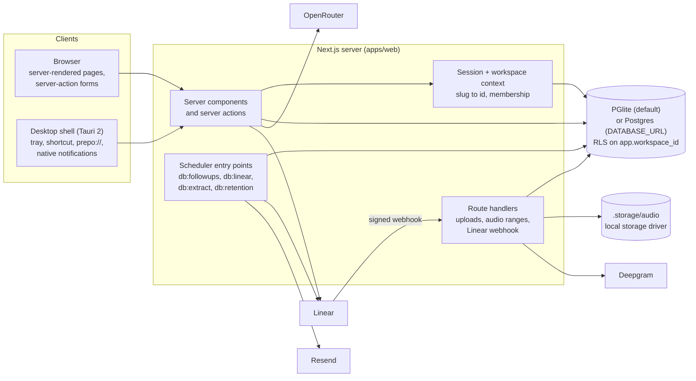

# Architecture

Prepo turns a meeting into assigned tickets and chases them. This document
describes the system that exists in this repository on 21 October 2026, not the
system proposed in `PREPO.md`. Where the two differ, the difference is named
here and in the relevant ADR under [`docs/adr/`](./docs/adr/README.md).

The short version: a Next.js server renders every page, checks the session and
the workspace membership on the server, then reads and writes through a
transaction that the database scopes to one workspace with row-level security.
Long work is a row plus a scheduler-invoked pass. There is no queue service, no
socket channel, no object store and no hosted deployment in this repository.

## The shape



One request, in one line: `cookie -> session row -> slug -> workspace id ->
membership -> withWorkspace(RLS) -> render`. A mutation is the same path, then a
write and `revalidatePath`; the reply is a re-render, not a client-side store.

## What runs where

| Piece | What it is | What it owns |
|---|---|---|
| `apps/web` | Next.js 16.4 (App Router), React 19.3, TypeScript, Tailwind 4, Drizzle 0.45 | Every page, server action, route handler, the database schema and migrations, and the scheduler entry points |
| `apps/desktop` | Tauri 2 shell (Rust + a static frontend directory) | A native window, tray, global shortcut, single instance, window state, native notifications, `prepo://` links. No product logic and no data |
| `packages/shared` | Constants, Zod schemas and sample data | Vocabulary shared by the web app and its scripts; no runtime service |
| `packages/config` | Base and Next.js TypeScript configs | Compiler settings only |

The database is Postgres, either compiled to WASM (`@electric-sql/pglite`
0.5.10, the default, at `.pglite`) or a real Postgres when `DATABASE_URL` is
set. The schema, migrations, policies and queries are identical; see
[ADR 0002](./docs/adr/0002-pglite-workbench-postgres-by-url.md). Audio is the one
thing outside the database, behind a storage driver; see
[ADR 0005](./docs/adr/0005-audio-behind-a-storage-driver.md).

## A request, end to end

1. **Session.** `readSession` takes the `__Host-prepo_session` cookie (plain
   `prepo_session` outside production), hashes the token and looks up the
   `sessions` row. The row must be unrevoked, inside its 30-day absolute
   lifetime, and touched within the last 7 days. The cookie is HttpOnly,
   SameSite=Lax, Path=/. Only the hash is stored; the plaintext token exists
   only in the response that created it.
2. **Tenant.** `requireWorkspace(slug)` resolves the slug through the
   `resolve_workspace_id` security-definer function, loads the workspace and its
   members, and finds the caller's membership. A non-member gets a 404, not a
   403, so the app never confirms that another tenant exists.
3. **Scoped read.** Queries go through `withWorkspace(id, tx => ...)`, which
   opens a transaction, switches to the non-owner `prepo_app` role and sets
   `app.workspace_id` with `set local`. Every policy compares the row's
   `workspace_id` to that setting; unset means no rows. See
   [ADR 0001](./docs/adr/0001-tenant-isolation-in-postgres-rls.md).
4. **Mutation.** A server action re-checks the role it needs (owner/admin for
   credentials and destructive writes), writes inside the same kind of
   transaction, and revalidates the workspace layout. A client sends the slug
   that is already in its URL; it never sends a workspace id it chose.
5. **Deferred work.** If the mutation concerns Linear, it writes
   `linear_sync_state = pending` on the ticket and returns. If it schedules a
   follow-up, it writes a `followups` row. Neither waits for a network call. The
   exception is audio ingestion: transcription runs inline in the upload
   request (ADR 0003).

## Data model

Twenty-five tables. The groups matter more than the columns:

| Group | Tables | Notes |
|---|---|---|
| Identity | `users`, `sessions`, `accounts`, `auth_events`, `login_challenges` | Not workspace-scoped: sign-in happens before a tenant exists. Sessions are hashed tokens; `accounts` holds the argon2id password hash; `auth_events` records sign-in outcomes; `login_challenges` carries the five-minute half-finished sign-in for TOTP |
| Tenancy | `workspaces`, `memberships`, `invitations` | Roles are owner, admin, member; membership is checked on every request, not left to RLS alone |
| Meetings | `meetings`, `audio_assets`, `transcript_segments`, `action_items` | A meeting has at most one audio asset in practice, many segments and many proposed action items. Segments carry a maintained `tsv` |
| Work | `tickets`, `ticket_events`, `comments`, `followups`, `notifications`, `saved_views` | Approving an action item creates a ticket; the follow-up ladder and the Linear sync state are columns on the ticket's rows, not messages in a broker |
| Integration and records | `integrations`, `api_keys`, `share_links`, `ai_runs`, `stt_runs`, `audit_logs` | Integration tokens and webhook secrets are encrypted; AI and speech runs record model, tokens, cost and latency; audit rows are append-only |
| Declared, unused | `push_subscriptions` | The table exists for the specified web push; no code writes to it and no VAPID key is configured |

Every workspace-scoped table has `workspace_id` and a policy. Foreign keys are
`ON DELETE cascade` from the workspace down, which is why "delete a workspace"
is one statement and why the restore drill checks ticket-to-workspace mapping.

## The pipelines

### 1. Transcript or recording to a meeting

- **Transcript file** (`.vtt`, `.srt`, `.txt`, `.md`): parsed server-side into
  speaker-labelled segments. `.docx` and `.pdf` are refused with "paste the text
  instead" rather than run through a parser (no parser is installed).
- **Audio** (`.mp3`, `.m4a`, `.wav`, `.webm`, `.ogg`, `.mp4`): 4 MB pieces
  appended through the chunk route, capped at 25 MB and 3 hours. The type is
  sniffed from bytes, not the extension. Bytes go to the storage driver, a
  SHA-256 and the size are recorded, and transcription runs inline against
  Deepgram (`nova-3`, diarized) when `DEEPGRAM_API_KEY` is set. Without a key the
  recording is stored and the asset says there is no transcript; it does not
  pretend one exists.
- A failed transcription records the provider's words and offers a retry; it is
  not silently marked done.
- Retention defaults to 30 days after transcription (choices: immediately, 7,
  30, 90, forever); `db:retention` is the sweep that deletes bytes and reclaims
  abandoned uploads and never-transcribed recordings after 90 days.

### 2. Transcript to tickets

- Extraction is one OpenRouter call with a JSON Schema, gated by Zod and then by
  grounding: every item must quote text that exists in the transcript, located
  to a span. Failed items are dropped and counted.
- The model has no tools. The server inserts the meeting summary, key decisions,
  open questions and proposed action items; autonomy decides whether an item is
  auto-approved (`suggest` none, `assist` only with a resolved owner and a real
  date, `autopilot` all).
- Approving an action item creates a ticket with a workspace-scoped key, a
  position, an optional owner and due date. A ticket change schedules its
  follow-up ladder.
- Caps: 120,000 characters per extraction, 200 runs per workspace per month.
  A longer transcript is refused, never truncated mid-argument.

### 3. The chase

- The ladder is arithmetic on the due date (four rungs), not a cron expression:
  `src/server/followups/ladder.ts` is a pure function of `dueAt`, and every
  consumer uses it. Moving the due date rebuilds the ladder and cancels rungs
  whose moment no longer exists.
- `db:followups` works the due rows: deliver email (Resend when configured),
  write an in-app notification, fail with a reason, defer for quiet hours in the
  recipient's zone, or cancel because the ticket is done, deleted or moved. A
  digest is built per person. Refused email is recorded `failed` with the
  provider's reason, never `sent`.
- There is no verified Resend sending domain on this deployment, so a live send
  is refused and recorded. The in-app half of the same rung still lands, which
  is what makes the queue observable without mail.

### 4. Linear, two ways

- `connectLinear` validates the personal key against Linear (viewer and teams)
  before storing an encrypted copy; the team is chosen explicitly. A connection
  without a team cannot push and says so.
- A ticket change queues a push. `db:linear` pulls everything changed since
  `integrations.last_synced_at`, then pushes pending tickets with per-ticket
  retry and backoff (1m, 5m, 15m, 60m, then 6h). The pull cursor advances even
  when one issue cannot be applied, so one bad issue cannot wedge the queue.
- The signed webhook and the pull apply changes through the same function, so a
  delivery and a poll cannot resolve a conflict differently. Signature is
  HMAC-SHA256 over the raw body in constant time, with a 60-second window; the
  secret is per workspace and encrypted.
- Comments, attachments and sub-issues are not synced.

## Trust boundaries

| Boundary | What crosses | Control |
|---|---|---|
| Browser to server | A session cookie, form fields, file bytes | Session verified against the database; tenant derived from the URL slug plus membership, never from a client-supplied id; every file type sniffed and capped; server actions re-check roles |
| Server to database | SQL, with a workspace scope | `set local role prepo_app` plus `app.workspace_id`, forced RLS, default deny; the owner role is used only for bootstrap and operator scripts |
| Server to OpenRouter | Transcript text, prompt, workspace vocabulary | `OPENROUTER_API_KEY` server-side only; no model-facing tools; transcript is data; usage recorded in `ai_runs` without the prompt |
| Server to Deepgram | Recording bytes | `DEEPGRAM_API_KEY` server-side only; the endpoint is the configured provider and nothing else; usage recorded in `stt_runs` |
| Server to Resend | Recipient address, subject, body | `RESEND_API_KEY` server-side only; refusals recorded with the provider's words; no verified domain here |
| Server to Linear | Ticket fields, the personal token | Token encrypted at rest (AES-256-GCM, key outside the database); per-ticket retry; the request never waits |
| Linear to server | A signed webhook | HMAC per workspace, constant-time compare, 60-second timestamp window, payload parsed before verification but not acted on; missing secret means refused |
| Desktop shell to web | The web app's own origin | No window capabilities, `withGlobalTauri: false`, a shell CSP, non-app origins handed to the system browser, `prepo://` parsed with the workspace as authority |

## Deliberate absences

These are decisions, not a backlog being hidden:

| Absent | What exists instead | Why |
|---|---|---|
| Embeddings / pgvector | Postgres `tsvector` + `websearch_to_tsquery`, citations checked against the sent passages | [ADR 0004](./docs/adr/0004-full-text-retrieval-without-embeddings.md) |
| Inngest | Idempotent CLI passes over rows, with backoff on the ticket | [ADR 0003](./docs/adr/0003-row-and-a-pass-instead-of-a-workflow-engine.md) |
| Ably / realtime | Server-rendered pages and `revalidatePath` | [ADR 0009](./docs/adr/0009-no-realtime-channel-yet.md) |
| R2 / presigned URLs | A storage driver over the local filesystem, authorization per request | [ADR 0005](./docs/adr/0005-audio-behind-a-storage-driver.md) |
| Web push | In-app notifications and email | No subscription writer and no VAPID key |
| Installers, signing, updater | A Tauri shell that refuses to update | No endpoint, no signing key, nothing published |
| Evals, Lighthouse, axe, ZAP, `cargo audit` | CI suites and scans that do not need a browser or a host | [ADR 0010](./docs/adr/0010-ci-is-the-enforcement-point.md) |

## How the invariants are checked

The check suites are scripts, not a test framework, and each fresh suite creates
its own database directory. CI runs them on every push.

| Invariant | Check |
|---|---|
| No cross-tenant read, including audio and transcripts | `db:auth`, `db:smoke`'s workspace checks, `db:idor-smoke`'s HTTP refusals, the restore drill's tenant boundary |
| Uploads cannot smuggle a type, exceed a cap or unpack an archive | `db:audio` (98 checks, including an empty file, a zip refused without unpacking, a WAV header overriding a short claim, and unknown extensions served opaque) |
| An authorised caller still cannot exceed the chunk cap | `db:idor-smoke` (25 checks; 4 MB + 1 byte answered 413) |
| A poisoned transcript cannot act | `db:injection-smoke` (38 checks) |
| Ask Prepo cites only what it was sent | `db:ai-smoke` (56 checks) and the citation check in `ask.ts` |
| The follow-up ladder, quiet hours and refusals are recorded honestly | `db:followup-smoke` |
| Extraction grounds every item and drops the rest | `db:extract-smoke` |
| Webhook signatures, the replay window and echoed pushes | `db:linear-smoke` |
| A backup restores only its own data | `db:restore-drill` (12 checks, in CI on a dataset the job builds) |
| The installable app's manifest, worker and offline page | `pwa:check` (55 checks) |

## Running it

```bash
pnpm install
pnpm --filter @prepo/web db:migrate
pnpm --filter @prepo/web db:seed
pnpm dev                       # http://localhost:3000
```

The environment is read from `apps/web/.env.local` (git-ignored). The names and
what happens when each is absent are in `README.md`; in short: no
`INTEGRATION_ENCRYPTION_KEY` means Linear cannot be connected at all, no
`OPENROUTER_API_KEY` means extraction and Ask Prepo are unavailable, no
`DEEPGRAM_API_KEY` means a recording is stored without a transcript, and no
`RESEND_API_KEY` or verified domain means email is refused and recorded. None of
those failures is silent.

There is no hosted deployment. This means ZAP, securityheaders, Lighthouse, axe
and a real installer test cannot be run, and this document does not claim them.

## Where to read next

- [`docs/adr/`](./docs/adr/README.md) - the decisions and their costs.
- [`README.md`](./README.md) - per-feature behaviour, including the honest edges.
- [`SECURITY.md`](./SECURITY.md) - the threat model and the OWASP mapping.
- [`DESIGN.md`](./DESIGN.md) - the design system and the build log.
- [`PREPO.md`](./PREPO.md) - the specification this was built against.
