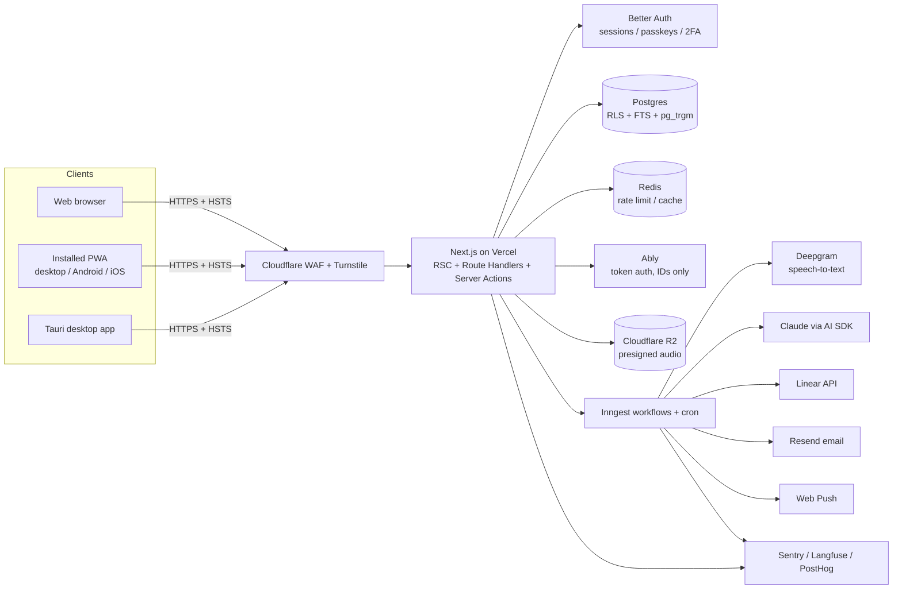
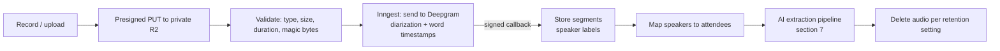
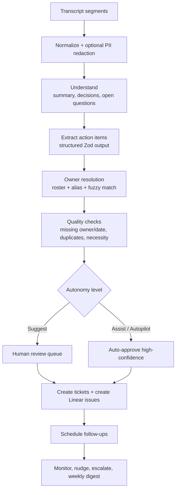
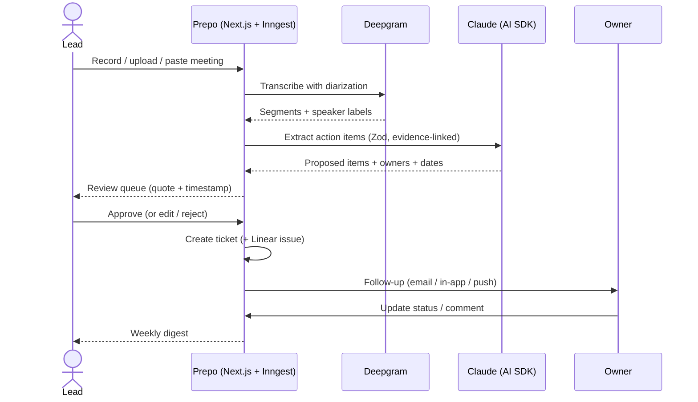

# Prepo — Project Specification (v2)

> **Prepo** is an AI agent that acts as a proxy project manager. It turns meetings (recordings or minutes) into assigned tickets and keeps following up until the work is done.
> Tagline: *The meeting ends. The work starts.*
> **Delivery:** one codebase that runs as a **website**, installs as an **app on any device (PWA)**, and ships as a **native desktop app (Tauri)**.

**Design read:** AI SaaS landing page + authenticated, installable web app for team leads and PMs (and recruiters scanning a developer portfolio), with a clean, confident, minimalist language, leaning toward Tailwind v4 + shadcn/ui + Geist + restrained motion.

### What changed from v1

| Topic | v2 decision |
|---|---|
| Platform | Web + installable PWA + Tauri desktop shell (new section 3) |
| Audio | Record in-app or upload recordings, transcribed with speaker labels (new section 6) |
| Embeddings | **Removed.** No embeddings key, no pgvector. Search uses Postgres full-text + trigram, and Claude reads the retrieved passages |
| Ticket tracker | **Linear only**, built deeply (two-way sync). Jira / GitHub / Slack dropped |
| Realtime | **Ably** (recommended pick) |
| Follow-up channels | **Email + in-app** (+ native push/desktop notifications, which come free with an installable app) |
| Language | **English only** for UI and landing. i18n layer removed |
| Domain | Not required now. Works on a free `*.vercel.app` URL (caveat in 12.2). **As built:** the name this row suggested is taken by another app, so the origin is `APP_URL`, defaulting to localhost |

---

## 0. Product Brief

### 0.1 Problem

| # | Pain point | What it causes |
|---|---|---|
| 1 | Meetings often produce long minutes that confuse people and contain no clear instructions | Nobody knows what to do next |
| 2 | Information overload after the meeting. The minutes record the whole debate but fail to extract action items | Team members lose context about who must do what |
| 3 | Responsibility is passed around, projects stall, and a corporate disease appears: the *meeting to discuss a meeting* | Execution never starts |

### 0.2 Solution

An AI agent that acts as a PM proxy to make sure execution is completed:

1. **Action-Item Extraction** — find tasks, owners, deadlines, and priorities in recordings, transcripts, or raw minutes.
2. **Auto-Ticketing Execution** — turn approved action items into tickets (internal board, mirrored into Linear).
3. **Automated Follow-Up** — remind, escalate, and report progress until each ticket is done.

### 0.3 Outcome

The move from table discussion to field execution becomes instant. Every team member's responsibility is transparent, and productivity rises because no one is confused about instructions.

### 0.4 Target users

| Persona | Need |
|---|---|
| Team lead / PM | Stop chasing people manually after every meeting |
| Team member | One clear list of "what is mine, by when" |
| Executive / stakeholder | Read-only visibility into whether decisions became work |
| Recruiter / hiring manager (portfolio angle) | See a production-grade full-stack + AI build with real security practice |

---

## 1. Tech Stack

> Principle: one well-chosen tool per job, TypeScript end to end, every dependency verified in `package.json` before import (install command first, never assume).

### 1.1 Frontend and shared

| Layer | Choice | Why |
|---|---|---|
| **Language** | TypeScript (strict) | Type safety from DB to UI |
| **Framework** | Next.js (App Router, latest stable) + React 19 | RSC by default, Server Actions, Route Handlers, streaming |
| **Runtime** | Node.js LTS (≥ 22) | Stable |
| **Package manager** | pnpm (workspace) | Fast, strict |
| **Styling** | Tailwind CSS v4 (`@tailwindcss/postcss`) + CSS-variable tokens | Utility-first, `dark:` variant |
| **UI components** | shadcn/ui (Radix primitives), restyled with Prepo tokens, never default state | You own the code, accessible |
| **Animation** | Motion (`motion/react`); GSAP + ScrollTrigger only for pinned landing sections | Light by default |
| **Icons** | `@phosphor-icons/react` (one family, one weight) | Consistent, no hand-rolled SVG |
| **Charts** | shadcn Chart (Recharts) | Themeable, accessible |
| **Fonts** | Geist Sans + Geist Mono via `next/font` (self-hosted) | No layout shift |
| **Forms / validation** | React Hook Form + Zod (one schema for forms, API, and AI output) | Single source of truth |
| **Client data** | TanStack Query | Cache, optimistic updates |
| **Client state** | Zustand (UI-only) | Tiny |
| **Tables / DnD** | TanStack Table · dnd-kit | Dense tables, accessible kanban |
| **Date/time** | date-fns + date-fns-tz (user timezone auto-detected) | Timezone-aware follow-ups |
| **PWA** | Serwist (`@serwist/next`) service worker + Web App Manifest | Installable, offline reads, push. **As built:** a web app manifest (`app/manifest.ts`), generated icons and a **hand-written** service worker at `public/sw.js` — no Serwist, and therefore no build-time precache manifest to trust. Installing is real; **offline reads and push are not built**, because the worker deliberately caches no rendered page (see 3.1) |
| **Desktop shell** | **Tauri 2** (Rust) wrapping the hosted web app | Small installer, strong security model |
| **Audio capture** | `MediaRecorder` API + `getDisplayMedia` (tab audio where supported) | In-browser recording |

> No i18n library. All copy is English and lives in typed constants so it can be extracted later if needed.

### 1.2 Backend

| Concern | Choice |
|---|---|
| API | Next.js Route Handlers (REST, `/api/v1`) + Server Actions. OpenAPI generated from Zod |
| ORM / migrations | Drizzle ORM + drizzle-kit |
| Auth | Email + password (argon2id), **TOTP 2FA with recovery codes**, per-device sessions with revoke, lockout + rate limits, organizations/roles. Implemented directly on the `users`/`accounts`/`sessions` tables in 4.5 rather than via Better Auth, so the identity model matches the documented schema and stays driver-agnostic (PGlite or Postgres). Magic link, Google/GitHub OAuth, passkeys (WebAuthn), breached-password check and Turnstile are still to be added |
| Background jobs | Inngest (durable workflows, cron, retries) for the audio → transcript → extraction → ticket pipeline and the follow-up scheduler. **As built:** not wired yet. Audio ingest runs inline in the route handler that received the bytes; retention is the `db:retention` script, the follow-up chaser is `db:followups`, and extraction is `db:extract` (the meeting page's button calls the same function) — all written to be called from any scheduler, all printing a per-row decision line |
| Realtime | **Ably**, token auth with per-workspace capabilities. Events carry IDs only, clients refetch through the authorized API |
| File / audio storage | Cloudflare R2 (S3-compatible), private bucket, presigned URLs, lifecycle auto-delete. **As built:** a local filesystem driver behind a `StorageDriver` interface, because there is no R2 account on the build machine. The interface deliberately has **no presign method**, so audio is never publicly addressable — playback is an authorization-checked route that streams byte ranges |
| Speech-to-text | **Deepgram** (speaker diarization + word timestamps), behind a `TranscriptionProvider` interface so OpenAI or others can be swapped in. **As built:** the interface is `transcribe(bytes, opts)` rather than `transcribe(audioUrl, opts)` — bytes keep a user-supplied URL from ever becoming an outbound request. The provider is unconfigured without `DEEPGRAM_API_KEY` |
| Linear | `@linear/sdk` (OAuth 2.0 app, GraphQL, signed webhooks) |
| Email | Resend + React Email. **As built:** Resend, called from the chaser with a key read from the environment. With no `RESEND_API_KEY` the row is marked `failed` with the reason instead of being marked sent, and the in-app half of the same rung is still delivered. With a key but no verified sending domain, Resend refuses every recipient but the account's own and the refusal is recorded verbatim |
| Web Push | `web-push` with self-generated VAPID keys (no third-party service). **As built:** not implemented — no subscription table, no VAPID keys, no `push_subscriptions` rows, nothing to send with. The service worker from 3.1 exists but is not a subscription: the ladder still lists push on the nudge rung, and the engine refuses to write a push row while no device is subscribed, so nothing is pretended |
| Rate limiting | Upstash Redis + `@upstash/ratelimit` |
| Document parsing | `mammoth` (.docx), `pdf-parse` (.pdf), native parsers for `.txt .md .vtt .srt`. **As built:** the native parsers only. `.docx` and `.pdf` are refused with a reason ("paste the text instead") rather than parsed, so no document parser is installed and there is no parser to attack |
| Bot protection | Cloudflare Turnstile on auth and public endpoints |

### 1.3 Database and search (no embeddings)

| Item | Choice |
|---|---|
| Primary DB | PostgreSQL 16+ (Neon serverless, or Supabase Postgres) |
| Search | Postgres **full-text search** (`tsvector`, `english` config) + **`pg_trgm`** for typo-tolerant names and titles |
| Cache / rate-limit store | Upstash Redis |
| Isolation | Row Level Security keyed on `workspace_id` |
| IDs | UUIDv7 |

**How "Ask Prepo" works without embeddings:** the query is turned into keyword search terms by a fast model, Postgres returns the top matching transcript chunks and tickets (ranked with `ts_rank` + trigram similarity), then Claude reads those passages and answers with citations. Claude's large context window makes this accurate for team-sized data. Embeddings can be added later behind the same interface if search quality ever needs it. **As built: `websearch_to_tsquery` over the `tsvector` column is the query rewrite; the fast-model step was not built, so `AI_MODEL_FAST` stays unread. Passages are ranked transcript lines plus the workspace's recent meetings and its tickets, and the model answers in one non-streamed call with citations that resolve against the passages that were sent.**

### 1.4 AI layer

| Item | Choice |
|---|---|
| SDK | Vercel AI SDK (`ai`) with OpenRouter as the provider, so the vendor is a model id rather than a dependency. **As built:** OpenRouter's OpenAI-compatible endpoint over `fetch`, so no AI SDK dependency is installed; the provider seam is our own `ExtractionProvider` |
| Model | Reached through `OPENROUTER_API_KEY` (server-side only). Model IDs live in env (`AI_MODEL_EXTRACT`, `AI_MODEL_FAST`) and are checked against current docs before first run. **As built:** `AI_MODEL_EXTRACT` only; the configured id was taken from OpenRouter's live model list (`/api/v1/models`) |
| Structured output | `generateObject` / `streamObject` with Zod. **As built:** a JSON Schema `response_format` (with a JSON-mode fallback) and the same Zod schema as the arrival gate |
| Agent tools | Typed tool calls with a hard allow-list: `create_ticket`, `assign_owner`, `schedule_followup`, `search_meetings`. **As built:** no model-facing tools at all; extraction returns JSON and the server decides what to write |
| Observability | Langfuse (or an `ai_runs` table): prompts, latency, tokens, cost, eval scores. **As built:** `ai_runs` with model, tokens, cost, latency and the meeting id as `traceId`; no prompt tracing. Ask Prepo records the same fields with purpose `ask_workspace` and a null `traceId`, because the question is the one piece of free text a person writes here and it is not stored |
| Evals | Golden transcripts scored on owner / deadline / action-item F1, gated in CI. **As built:** not implemented (7.5) |

### 1.5 Tooling, quality, DevOps

| Area | Choice |
|---|---|
| Lint/format | ESLint (flat) + Prettier + `eslint-plugin-security` |
| Tests | Vitest + Testing Library + MSW · Playwright (desktop + mobile viewports, `axe-core`) |
| Git hooks | Husky + lint-staged + commitlint |
| CI/CD | GitHub Actions: typecheck, lint, test, build, Lighthouse CI, CodeQL, `gitleaks`, `pnpm audit`, Dependabot. **Tauri release workflow** builds macOS / Windows / Linux installers and publishes to GitHub Releases |
| Hosting | Vercel (app) + Neon (DB) + Upstash (Redis) + Inngest Cloud + Cloudflare R2 + Ably |
| Containers | `Dockerfile` + `docker-compose.yml` (app, Postgres, Redis, MinIO as local R2 stand-in) |
| Monitoring | Sentry, PostHog, Vercel Analytics |
| Docs | `README.md`, `SECURITY.md` (repository root, as GitHub expects), `ARCHITECTURE.md` (Mermaid), ADRs |

### 1.6 Packages to install (reality anchor)

```bash
pnpm create next-app@latest prepo --ts --tailwind --app --src-dir --eslint --import-alias "@/*"
pnpm dlx shadcn@latest init
pnpm add motion gsap @phosphor-icons/react geist zod react-hook-form @hookform/resolvers \
  @tanstack/react-query @tanstack/react-table zustand @dnd-kit/core @dnd-kit/sortable date-fns date-fns-tz \
  drizzle-orm @neondatabase/serverless better-auth inngest resend @react-email/components \
  @upstash/redis @upstash/ratelimit ably ai @openrouter/ai-sdk-provider @deepgram/sdk @linear/sdk \
  @aws-sdk/client-s3 @aws-sdk/s3-request-presigner web-push @serwist/next mammoth pdf-parse
pnpm add -D drizzle-kit serwist vitest @testing-library/react msw playwright @axe-core/playwright \
  eslint-plugin-security husky lint-staged @commitlint/cli simple-icons @tauri-apps/cli
```

---

## 2. Design System

### 2.1 Direction

- **Language:** minimalist-editorial SaaS. Calm, high contrast, lots of air, one coral accent. No AI-purple, no mesh-gradient hero, no default Inter + slate.
- **Brand cues from your board:** coral-pink sticky notes (the chaos of unclear meeting output) against a near-black wordmark bar (the order Prepo brings). **Coral = the mess and the signal, near-black = the clean result.**
- **One palette, one accent, locked.** Functional status colors exist only inside the app UI (2.3.4) and are never decorative.
- **Light and dark mode from day one**, via CSS variables and `prefers-color-scheme` (user can override).
- **App-like feel when installed:** safe-area insets, no rubber-band overscroll on app chrome, native-feeling title bar on desktop (see 3.3).

### 2.2 Typography

| Role | Font | Notes |
|---|---|---|
| Display / headings | **Geist Sans** | `tracking-tighter leading-none` on display sizes |
| Body / UI | **Geist Sans** | `leading-relaxed`, `max-w-[65ch]` for paragraphs |
| Code / IDs / timestamps | **Geist Mono** | Ticket IDs (`PRE-142`), transcript timestamps, API keys |
| Emphasis in headlines | *Italic or bold of the same family* | No mixed-family emphasis, no serif |

**Type scale:**

| Token | Size | Usage |
|---|---|---|
| `display-xl` | `text-4xl md:text-5xl lg:text-6xl`, `leading-none` | Hero headline (max 2 lines desktop) |
| `display-lg` | `text-3xl md:text-4xl` | Section headlines (≤ 8 words) |
| `title` | `text-xl` | Card and panel titles |
| `body-lg` | `text-lg` | Hero subtext |
| `body` | `text-base` | Default |
| `body-sm` | `text-sm` | App UI default, table cells |
| `caption` | `text-xs` | Metadata (never below 12px) |
| `mono-sm` | `text-xs font-mono` | IDs, timestamps |

Italic display words containing `y g j p q` use `leading-[1.1]` minimum plus `pb-1`.

### 2.3 Color tokens

#### 2.3.1 Neutrals (Zinc, one family only)

| Token | Light | Dark | Use |
|---|---|---|---|
| `--bg` | `#FAFAFA` | `#09090B` | Page |
| `--surface` | `#FFFFFF` | `#111113` | Cards, popovers |
| `--surface-2` | `#F4F4F5` | `#18181B` | Subtle fills, inputs |
| `--border` | `#E4E4E7` | `#27272A` | Hairlines |
| `--border-strong` | `#D4D4D8` | `#3F3F46` | Input borders |
| `--text` | `#09090B` | `#FAFAFA` | Primary text |
| `--text-muted` | `#52525B` | `#A1A1AA` | Secondary text |
| `--text-subtle` | `#71717A` | `#8B8B94` | Captions |
| `--ink` | `#0B0B0C` | `#0B0B0C` | The "Prepo" black bar / footer lockup |

#### 2.3.2 Accent: Prepo Coral

| Token | Light | Dark | Use |
|---|---|---|---|
| `--accent` | `#FF6B6B` | `#FF7A7A` | Primary buttons, key highlights |
| `--accent-fg` | `#09090B` | `#09090B` | **Text on accent** (near-black on coral ≈ 7:1; white would fail) |
| `--accent-ink` | `#C2272D` | `#FF9A9A` | Accent used as text/icon on bg (≥ 4.5:1) |
| `--accent-soft` | `#FFE9E9` | `#2A1415` | Tinted backgrounds |
| `--accent-note` | `#FFB3B3` | `#5A2427` | Sticky-note surfaces (landing) |
| `--ring` | `#FF6B6B` | `#FF7A7A` | Focus ring (2px + 2px offset) |

#### 2.3.3 Rules

- Coral gradients only as a soft `accent-soft → accent-note` wash or one radial highlight. No neon, no purple.
- Shadows tinted to the background hue: light `rgb(24 24 27 / 0.08)`, dark `rgb(0 0 0 / 0.5)`. Hero cards may add `0 8px 32px rgb(255 107 107 / 0.14)`.
- Every text/background pair checked against WCAG AA. Buttons, placeholders, helper and error text are audited explicitly.

#### 2.3.4 Functional status colors (app UI only, always icon + label)

| Status | Color | Icon (Phosphor) |
|---|---|---|
| Backlog | `--text-subtle` | `Circle` |
| To do | `--text-muted` | `CircleDashed` |
| In progress | `--accent-ink` | `CircleHalf` |
| In review | `--text` | `Eye` |
| Done | `#15803D` / `#4ADE80` | `CheckCircle` |
| Blocked / Overdue | `#B91C1C` / `#F87171` | `WarningCircle` |

### 2.4 Shape (one documented rule)

| Element | Radius |
|---|---|
| Buttons, inputs, selects, tabs | 10px |
| Cards, panels, dialogs, popovers | 16px |
| Sheets, large hero visuals | 24px |
| Avatars, tags, status chips | full |
| Sticky notes (landing) | 6px, ≤ 2° rotation |

### 2.5 Spacing and layout

- **Base unit:** 4px. **Container:** `max-w-7xl mx-auto px-4 sm:px-6 lg:px-8` (app content `max-w-[1400px]`).
- **Landing rhythm:** `py-16 md:py-24`. Hero top padding **max `pt-24`**.
- **Grids:** CSS Grid only. No `calc(33%-1rem)` flex math.
- **Viewport:** hero `min-h-[100dvh]`, never `h-screen`.
- **Breakpoints:** `sm 640 / md 768 / lg 1024 / xl 1280 / 2xl 1536`. Every asymmetric layout collapses to one column below `md`, declared per component.
- **Nav:** single line on desktop, 64px.
- **Safe areas:** `env(safe-area-inset-*)` on app chrome, `viewport-fit=cover`.
- **Z-index scale (one constants file):** `base 0 · sticky 10 · nav 20 · dropdown 30 · overlay 40 · modal 50 · toast 60 · grain 70`

### 2.6 Elevation

| Level | Use | Style |
|---|---|---|
| 0 | Page | flat |
| 1 | Cards where hierarchy matters | 1px border, no shadow |
| 2 | Popovers, menus | tinted shadow + border |
| 3 | Modals, command palette | tinted shadow, `blur(8px)` backdrop with solid fallback under `prefers-reduced-transparency` |

Cards only where elevation signals hierarchy; otherwise `divide-y`, `border-t`, or whitespace.

### 2.7 Motion

| Token | Value |
|---|---|
| Easing | `cubic-bezier(0.16, 1, 0.3, 1)` |
| Duration | micro 120ms · UI 200ms · reveal 600ms |
| Stagger | 60ms |
| Press | `active:scale-[0.98]` |

Animate `transform` and `opacity` only. Everything above `MOTION_INTENSITY 3` honors `prefers-reduced-motion`. Continuous values use `useMotionValue` / `useScroll`, never `useState` or scroll listeners. Motion components are isolated `'use client'` leaves.

### 2.8 Interaction states

- **Loading:** skeletons shaped like final layout. **Empty:** one clear next action. **Error:** inline for forms, toast only for transient.
- Hover / focus-visible / active / disabled all defined.
- **Forms:** label above, helper in markup, error below, `gap-2`, no placeholder-as-label.
- **Buttons:** one line on desktop, 1–3 words, **one label per intent per page**.

### 2.9 Iconography and imagery

- Phosphor only, `regular` weight globally. No lucide, no hand-drawn icons.
- Logos via `simple-icons` in `currentColor` (works in both themes). Logo rows contain logos only.
- No div-built fake screenshots. Product visuals are real components with sample data, or real/generated images.
- No emoji in UI copy.
- **App icon set** (generated from one source mark): 192, 512, maskable 512, Apple touch 180, favicon, and desktop `.icns` / `.ico` / `.png` sizes.

### 2.10 Accessibility

WCAG 2.2 AA. Keyboard-complete (kanban has a menu alternative to drag), focus management in dialogs, `aria-live` for AI streaming, touch targets ≥ 44px, color never the only signal, `axe-core` in Playwright. The audio player and transcript are fully keyboard operable, and recording state is announced to screen readers.

---

## 3. Platforms: Web, Installable App, Desktop

One codebase, three ways to run it.

| Target | How | Best for |
|---|---|---|
| **Website** | Hosted Next.js app | Instant access, demo link, sharing |
| **Installable app (PWA)** | Web App Manifest + Serwist service worker. "Install" from the browser on desktop, Android, and iOS (Add to Home Screen) | Zero-friction install on every device |
| **Native desktop app** | **Tauri 2** shell for macOS, Windows, Linux, distributed through GitHub Releases | The "real software" experience: tray, global shortcut, native notifications |

### 3.1 PWA

- Manifest: name, short name, `display: standalone`, theme/background colors, icons (incl. maskable), `shortcuts` ("New meeting", "My tickets"), `share_target` (share a text/transcript file to Prepo from the OS).
- In-app **install prompt** (`beforeinstallprompt`) shown after a successful first meeting, dismissible and never repeated if dismissed. iOS shows a short "Add to Home Screen" guide.
- Service worker: precache the app shell, runtime-cache static assets, **stale-while-revalidate for safe read endpoints only** (recent tickets, meeting list). Authenticated API responses are never blanket-cached.
- Offline: read recent tickets and meetings, queue ticket edits and comments, replay on reconnect with conflict rules (9.1). A clear offline banner, with writes marked "queued".
- Updates: new-version toast with "Reload" (no silent mid-edit refresh).
- Web Push (VAPID) for follow-ups and review requests. On iOS this works only for the installed app.
- On logout or remote session revoke, all caches and IndexedDB data are cleared.

**As built (milestone 9).** The manifest is `src/app/manifest.ts`, served at
`/manifest.webmanifest`: real name, description, `start_url: "/"`, `scope: "/"`, `display:
standalone`, the app's own `--ink` as theme and background colour, and three icons — 192px, 512px,
and a 512px maskable rendering that bleeds to every edge. The mark is the desktop shell's mark. The
service worker is `public/sw.js`, hand-written rather than Serwist, and its policy is the one thing
here worth reading:

| Request | What the worker does |
|---|---|
| Any navigation (HTML) | network first, **never stored**, the offline page on failure |
| `/_next/static/*`, `/icons/*`, `/manifest.webmanifest`, `/offline.html` | cache first (hashed or versioned bytes) |
| not `GET`, another origin, or a `Range` request | untouched |
| everything else (`/api`, server actions, RSC payloads) | untouched |

**No HTML response is ever stored**, which is the deliberate opposite of the usual "precache the app
shell" advice: a browser cache belongs to the profile, not the session, so a stored board would show
one person's tickets to the next person who signs in on that machine. The consequence is stated
rather than hidden — `public/offline.html` is a self-contained page that says there is no offline
copy of your data, and it is the only page offline.

The install offer appears only when the browser actually offers installation (the event is captured
in the root layout before hydration, so a late offer is not missed), and never as a banner. What is
**not** built, from the list above: `shortcuts`, `share_target`, the post-first-meeting prompt,
stale-while-revalidate read endpoints, offline reads, queued edits, the offline write banner, the
new-version toast, Web Push, and the logout cache purge (there is nothing user-specific cached to
purge — which is the point). The worker's policy is asserted against its own source by
`pnpm --filter @prepo/web pwa:check` (55 checks); nothing here has run the worker in a browser.

### 3.2 Desktop app (Tauri 2)

The shell is a thin native window pointing at the hosted app. This keeps one source of truth, and server features (RSC, Server Actions, auth) keep working.

| Capability | Detail |
|---|---|
| Installers | `.dmg` (macOS), `.msi`/`.exe` (Windows), `.AppImage`/`.deb` (Linux) built by CI |
| Auto-update | Tauri updater with signed update manifests (signature verified before install) |
| Tray + menu bar | Quick actions: *New recording*, *Review queue (n)*, *Open board* |
| Global shortcut | Start/stop recording from anywhere (default `⌘/Ctrl+Shift+R`, configurable) |
| Native notifications | Overdue tickets, review requests, "transcript ready" |
| Deep links | `prepo://ticket/PRE-142`, `prepo://meeting/{id}` open the right screen |
| Single instance | A second launch focuses the existing window |
| Offline | Offline screen + app-level IndexedDB read cache. Service-worker support varies across OS webviews, so the desktop app does not depend on it |
| Window | Native title bar, remembers size/position, respects OS dark mode |

**Desktop security posture:** minimal Tauri capabilities (only the commands above are exposed to the web content), remote content limited to the allow-listed Prepo origin, strict CSP, navigation to any other origin opens the system browser, deep-link payloads validated, updater keys stored as CI secrets, code signing and notarization when certificates are available (see 12.2).

**As built (milestone 8).** The shell exists at `apps/desktop` and points at a **configurable**
address — `PREPO_DESKTOP_URL`, defaulting to `http://localhost:3000` — because there is no hosted
deployment to point at yet. Deviations from the table above, all stated in
`apps/desktop/README.md`:

- **Tray**: *New recording*, *Review queue*, *Board*, a test notification, an update check, quit.
  The review-queue count is not shown: nothing in the shell knows it.
- **Global shortcut**: `Ctrl/⌘ + Shift + R` opens the recorder rather than starting a recording.
  The shell grants no capability to the page, so no plugin command is reachable from it and the page
  cannot be told to start a recording.
- **Native notifications** are raised by the shell (the test item, the result of an update check).
  The app does not raise them yet, for the same reason.
- **Deep links** are `prepo://<workspace>/ticket/<KEY>` and `prepo://<workspace>/meeting/<id>`. A
  workspace is required: `prepo://ticket/PRE-142` cannot say whose ticket it is, so it is refused
  rather than guessed, as is any `prepo://` link carrying credentials or an unknown target.
- **Offline**: the shell's own page explains an unreachable app and offers a retry. There is no
  IndexedDB read cache, because the web app has no offline layer to reuse — it has no service
  worker at all.
- **Window**: native decorations, remembers position and size, and hands any non-app origin to the
  system browser. OS dark mode is the app's own (CSS `prefers-color-scheme` inside the webview).
- **Not built**: installers, the release pipeline, the signed updater (the plugin is registered
  with no endpoint and no key, and *Check for updates* says exactly that), code signing and
  notarization, and any bridge from the page in the window into the shell — no capability is granted
  to any window, so no plugin command is reachable from web content, remote or local.

Two checks stand in for a screen: `cargo test` (22 assertions covering the target-URL rules, the
`prepo://` grammar and workspace detection) and `desktop:verify` (48 checks covering the CSP,
capabilities, icons, scheme registration, updater honesty and version agreement). Neither proves
that the window renders or that a tray click does what its label says.

### 3.3 Feature matrix

| Feature | Web | PWA | Desktop |
|---|:-:|:-:|:-:|
| Full product | ✓ | ✓ | ✓ |
| Install icon / own window | | ✓ | ✓ |
| Offline reads + queued edits | | **not built** | **not built** |
| Push / native notifications | partial | **not built** | ✓ native |
| Mic recording | ✓ | ✓ | ✓ |
| Tab-audio capture | Chromium only | Chromium only | Planned (system audio) |
| Tray + global shortcut | | | ✓ |
| Auto-update | instant | instant | signed updater |

**As built (milestones 8–9):** the matrix is the specification's target; two PWA cells above are
therefore marked rather than ticked — installing works, and the offline data layer and push behind it
do not exist. The desktop column's `✓` rows are built but **not run by hand** and not packaged, so
"signed updater" and "auto-update" are configuration, not deliveries.

---

## 4. Architecture and Infrastructure

### 4.1 System diagram



### 4.2 Environments

| Env | Purpose | Data |
|---|---|---|
| `local` | Docker Compose | Seeded demo workspace |
| `preview` | Per-PR Vercel deploy | Neon branch DB per PR |
| `staging` | Pre-release | Anonymized seed |
| `production` | Live | Encrypted, PITR backups |

### 4.3 Environment variables (server-only unless `NEXT_PUBLIC_`)

```bash
# Core
DATABASE_URL=
UPSTASH_REDIS_REST_URL= / UPSTASH_REDIS_REST_TOKEN=
APP_URL=
# Auth
BETTER_AUTH_SECRET=
GOOGLE_CLIENT_ID= / GOOGLE_CLIENT_SECRET=
GITHUB_CLIENT_ID= / GITHUB_CLIENT_SECRET=
# AI  (you provide these; server-side only, never exposed to the browser)
# As built: OPENROUTER_API_KEY, AI_MODEL_EXTRACT and AI_MODEL_ASK are read. With
# either of the first two missing, extraction is refused and the UI names the
# missing variable. AI_MODEL_ASK is optional: Ask Prepo answers with it when it
# is set and with AI_MODEL_EXTRACT when it is not, and says which it is using.
OPENROUTER_API_KEY=              # one key, model chosen by id
AI_MODEL_EXTRACT=                # a model id from OpenRouter's live model list
AI_MODEL_ASK=                    # optional; the answering model for Ask Prepo
AI_MODEL_FAST=                   # not read (the fast-model query rewrite was not built; websearch_to_tsquery already reduces a question to its content words)
DEEPGRAM_API_KEY=
DEEPGRAM_CALLBACK_SECRET=        # verifies transcription callbacks
# Storage
R2_ACCOUNT_ID= / R2_ACCESS_KEY_ID= / R2_SECRET_ACCESS_KEY= / R2_BUCKET=
# Services
RESEND_API_KEY=
INNGEST_EVENT_KEY= / INNGEST_SIGNING_KEY=
ABLY_API_KEY=                    # server only; clients receive short-lived tokens
LINEAR_CLIENT_ID= / LINEAR_CLIENT_SECRET= / LINEAR_WEBHOOK_SECRET=
LINEAR_API_KEY=                  # linear's personal-key path; see 8.6 as built
VAPID_PUBLIC_KEY= / VAPID_PRIVATE_KEY= / VAPID_SUBJECT=
TURNSTILE_SECRET_KEY= / NEXT_PUBLIC_TURNSTILE_SITE_KEY=
SENTRY_DSN=
# Crypto
INTEGRATION_ENCRYPTION_KEY=      # 32-byte key for AES-256-GCM token encryption
```

Env is validated at boot with a Zod schema. The app refuses to start if anything is missing or malformed. No embeddings variable exists. `APP_URL` is optional and used only to print an absolute webhook address; nothing depends on it being set.

### 4.4 Repo structure (monorepo)

```
prepo/
├─ apps/
│  ├─ web/                       # Next.js (website + PWA)
│  │  ├─ src/app/(marketing)/ (auth)/ (app)/[workspace]/ api/v1/ api/inngest/
│  │  ├─ src/components/{ui,marketing,app,charts}/
│  │  ├─ src/server/{db,auth,ai,audio,jobs,integrations/linear,security}/
│  │  └─ public/ (manifest, icons, sw)
│  └─ desktop/                   # Tauri 2 shell (src-tauri/, capabilities, updater config)
├─ packages/
│  ├─ shared/                    # Zod schemas, types, constants
│  └─ config/                    # eslint, tsconfig, tailwind tokens
├─ docs/ (ARCHITECTURE.md, SECURITY.md, adr/)
├─ evals/                        # golden transcripts + scorers
├─ e2e/
├─ Dockerfile · docker-compose.yml · .github/workflows/
```

### 4.5 Data model (tenant tables carry `workspace_id`, protected by RLS)

| Table | Key fields |
|---|---|
| `users` | id, email, name, timezone, avatar_url |
| `sessions` | id, user_id, **token_hash (the session secret is stored hashed, never verbatim — 9.3 A02)**, device_label, **client_type (`web/pwa/desktop`)**, user_agent_hash, ip_prefix, last_seen_at, expires_at, revoked_at |
| `accounts` | provider links, **password_hash (argon2id PHC string)**, passkeys, totp_secret (encrypted), **totp_enabled_at, totp_recovery_code_hashes[]** |
| `workspaces` | id, name, slug, settings (JSON: autonomy level, follow-up tone, quiet hours, audio retention, chasing on/off, digest weekday) |
| `memberships` | workspace_id, user_id, role, aliases[] (name variants for owner matching) |
| `invitations` | token_hash, email, role, expires_at |
| `meetings` | id, title, held_at, source (`paste/upload/recording`), status, clarity_score, necessity_score |
| `audio_assets` | id, meeting_id, r2_key, duration_s, size_bytes, status, delete_after, consent_confirmed_by |
| `transcript_segments` | meeting_id, idx, speaker_label, speaker_user_id?, start_ms, end_ms, text, tsv |
| `action_items` | id, meeting_id, title, description, owner_id?, owner_raw, due_at?, priority, confidence, source_segment_ids[], status (`proposed/approved/rejected/ticketed`) |
| `tickets` | id, key (`PRE-142`), action_item_id, title, description, assignee_id, status, priority, due_at, labels[], position, version, **linear_issue_id, linear_url, linear_synced_at, linear_sync_state (`pending/synced/failed`), linear_sync_error, linear_sync_attempts, linear_retry_after** |
| `ticket_events` | ticket_id, actor (user or `prepo-agent`), type, payload |
| `comments` | ticket_id, user_id, body (sanitized) |
| `followups` | ticket_id (**null for a workspace-level digest**), recipient_id, kind (`reminder/nudge/escalation/digest`), channel (`email/in_app/push`), scheduled_for, sent_at, status (`scheduled/sent/failed/cancelled`), detail (why a send failed, or why a row was moved) |
| `notifications` | user_id, type, payload, read_at |
| `push_subscriptions` | user_id, session_id, endpoint, keys (encrypted), created_at |
| `integrations` | workspace_id, provider (`linear`), encrypted_token (**nullable — null after a disconnect**), **encrypted_webhook_secret, project_id, connected_by_id, last_synced_at, last_error**, team_id, mapping (JSON), source_of_truth, status |
| `api_keys` | workspace_id, name, prefix, hash, scopes, last_used_at, revoked_at |
| `share_links` | id, meeting_id, token_hash, created_by, expires_at, revoked_at, view_count |
| `saved_views` | id, user_id, scope (`board/tickets/meetings`), filters (JSON), is_shared |
| `ai_runs` | purpose, model, tokens_in/out, cost, latency_ms, trace_id, eval_score |
| `stt_runs` | audio_asset_id, provider, duration_s, cost, status |
| `audit_logs` | workspace_id, actor, action, target, ip_prefix, ua_hash (append-only) |
| `auth_events` | id, user_id?, email?, kind, ip_prefix, ua_hash, detail (JSON), created_at. Append-only identity-plane log: sign-in happens *before* a workspace is known (and sometimes against an address that has none), so these events cannot satisfy a `workspace_id`-scoped RLS policy |
| `login_challenges` | id, user_id, **token_hash**, kind (`totp`), expires_at, created_at — a half-completed sign-in (password checked out, second factor not yet presented). It is deliberately *not* a session: until the factor clears, the cookie only names a worthless 5-minute challenge |

---

## 5. Landing Page (`/`)

### 5.1 Rules locked for this page

- Hero fits the first viewport: headline ≤ 2 lines, subtext ≤ 20 words, CTAs visible without scrolling.
- Hero text stack max 4 elements: headline, subtext, primary CTA, secondary CTA. **No** tagline under CTAs, trust strip, pricing teaser, or avatar row.
- Eyebrows: max `ceil(sections / 3)`. Planned: 2 (Problem, Security).
- At least 4 distinct layout families. Max 2 consecutive image+text splits.
- One CTA label per intent: **"Try demo"** (try), **"Sign in"** (nav only), **"See how it works"** (secondary scroll), **"Install app"** (install intent, download section only).
- No fabricated statistics or customer claims. Illustrative content is labeled *sample*.
- English only, one copy register (plain, direct).

### 5.2 Sections

| # | Section | Layout family | Content and behavior |
|---|---|---|---|
| 1 | **Navbar** (sticky, 64px) | Single-line bar | Logo · *How it works* · *Features* · *Security* · *GitHub* · theme toggle · *Sign in* · **Try demo**. Sheet menu below `lg` |
| 2 | **Hero** | Asymmetric split 55 / 45 | H1: **"The meeting ends. The work starts."** Sub (19 words): *"Prepo reads your meeting minutes, creates a ticket for every action, and follows up with owners until it's done."* CTAs: **Try demo** + *See how it works*. Visual: a **live component preview** (real `ActionItemCard` stack fed by a sample transcript, streaming in on load, labeled *sample*). Single column on mobile |
| 3 | **Works-with row** | Static centered logo row | Logos only: Linear, Zoom, Google Meet, Microsoft Teams. Accessible label "Works with". Honest scope: Linear is a live integration, the meeting tools are supported by importing their transcripts or recordings |
| 4 | **Problem** *(eyebrow 1)* | Scattered sticky notes, asymmetric | Headline: *"Long minutes. Unclear actions."* Three coral notes from your board: (1) *"Meeting sessions often produce long minutes that confuse people, with no clear instructions."* (2) *"Information overload after the meeting: every debate is recorded, but action items never get extracted, so people lose context about who does what."* (3) *"Responsibility gets passed around, projects stall, and the corporate disease appears: a meeting to discuss a meeting."* Reveal with `whileInView` stagger. Mobile: stacked, no rotation |
| 5 | **How it works** | Pinned stacking cards (GSAP; static stack under reduced motion) | 3 steps: **Capture** (record or upload; minutes in, transcript out) → **Extract & ticket** (owners, deadlines, Linear issues) → **Follow up** (reminders and escalation until done). Each card shows the real UI component. Mobile: normal flow, no pin |
| 6 | **Features bento** | Bento, exactly 5 cells (1 large + 2 medium + 2 small) | **Action-Item Extraction** (large, quote-to-source), **Auto-Ticketing to Linear**, **Automated Follow-Up**, **Meeting Necessity Score** (flags "meeting about a meeting"), **Ask Prepo**. Background variety: one coral-wash cell, one `--ink` cell, one dot-pattern cell. Single column on mobile |
| 7 | **Before / After** | Full-width interactive toggle | Left: wall-of-text minutes. Right: same meeting as owner-assigned tickets with due dates. Headline: *"From discussion to execution."* Keyboard accessible |
| 8 | **Get the app** | Three-tile row (web, installable, desktop) | Open in browser · **Install app** (PWA prompt, iOS guide) · Download for macOS / Windows / Linux (GitHub Releases, OS auto-detected). Single column on mobile |
| 9 | **Security** *(eyebrow 2)* | 2 × 2 grouped chunks | **Access** (passkeys, 2FA, per-device sessions) · **Data** (workspace isolation, encryption, audio auto-delete) · **AI** (prompt-injection defenses, human approval) · **Assurance** (OWASP ASVS-aligned, audit log). Link to `SECURITY.md` |
| 10 | **FAQ** | Accordion | 6–7 plain questions: Is my data used for training? How is audio handled and deleted? Which tools connect? What can the AI do without approval? Can I self-host? Does it work offline? |
| 11 | **Final CTA + footer** | Full-width ink block | Headline + **Try demo**. Footer: giant "Prepo" wordmark on `--ink` (echoing the board), links (Privacy, Terms, Security, GitHub, Download) |

### 5.3 Behaviors

- Hero preview is interactive: click "Approve" on a proposed action item and watch it become a ticket.
- Nav border appears on scroll via `useScroll`, never a scroll listener. Theme persists via cookie (no flash).
- Performance: LCP < 2.5s, INP < 200ms, CLS < 0.1, Lighthouse ≥ 95, hero preloaded, heavy modules lazy-loaded.
- SEO: metadata API, dynamic OG image, `sitemap.xml`, `robots.txt`, JSON-LD (`SoftwareApplication` with `operatingSystem` list).
- `/download` page: install steps per platform (browser install and PWA) plus how to run the repository locally. When the desktop milestone lands this gains OS detection, installer downloads, checksums, release notes and an "unsigned build" notice.

### 5.4 Visual asset plan

| Placement | Spec |
|---|---|
| Hero, Problem, Before/After | Real components, no image needed |
| Bento: 2 image cells | 1 desaturated team-at-table photo (4:3) · 1 coral-to-ink texture (16:9) |
| Get the app tiles | Real app screenshots captured from the seeded demo (browser, phone, desktop frames) |
| OG image | 1200 × 630 via `next/og` |

Image slots stay labeled until real assets or generated images are supplied.

---

## 6. Audio and Transcription

### 6.1 Ways to bring a meeting in

| Method | Detail |
|---|---|
| **Record in the app** | Mic recording everywhere, optional **tab audio** capture in Chromium browsers (for online meetings). Pause/resume, visible timer, level meter. Audio uploads in chunks so a dropped connection does not lose the recording. **As built:** microphone only — `getDisplayMedia` is not implemented and the recorder says so — with pause/resume, timer, level meter and 2 MB chunked upload |
| **Upload a recording** | `.mp3 .m4a .wav .webm .ogg .mp4` (audio track extracted), size and duration caps per plan. **As built:** the container is sniffed from the bytes (WAVE, an MPEG frame sync, Matroska, ISO-BMFF brands) and the claimed extension is ignored; caps are 25 MB a file, 4 MB a piece, 4 hours a recording. The audio track is not extracted from `.mp4`/video — the file is stored as sent and the provider would decode it |
| **Upload a transcript** | `.vtt .srt .txt .md` (e.g., exported from Zoom, Meet, or Teams). `.docx` and `.pdf` are not parsed; the page tells you to paste instead |
| **Paste text** | Raw minutes. Parsed as `Speaker: line` paragraphs, stored untimed (`start_ms` null) so nothing pretends to know when it was said |
| **Share target (PWA)** | Share a file to Prepo from the OS share sheet. **Not built** — the manifest (3.1) exists, but it declares no `share_target`, and receiving a shared file would need the upload path behind it |

### 6.2 Pipeline



**As built** (the diagram above is the intended shape; these are the differences):

- **Storage** is the local filesystem driver, written directly by the route handler rather than
  presigned to R2, and the authorization-checked route serves it back with `206` byte ranges.
- **No Inngest.** Ingest — validate, store, transcribe, write segments — runs inline in the route
  handler that received the bytes. Retention is the `db:retention` sweep instead of a lifecycle rule.
- **Extraction is a script or a button, not an Inngest step.** `db:extract` (or the meeting page's
  Extract button) reads the transcript, calls the model **outside any transaction**, grounds the
  answer, and writes once. A meeting with no minutes keeps its transcript and no invented summary.
- **Speaker mapping is manual.** Labels come back as `Speaker 1/2/3` and the user attaches each to a
  workspace member in one form post; the automatic proposal from introductions and calendar
  attendees is not built.

- **Speaker mapping:** Deepgram returns `Speaker 1/2/3`. Prepo proposes a mapping to attendees (from introductions, names used in conversation, calendar attendee list when provided), and the user can correct it in one click.
- **Meeting detail with audio:** waveform player synced with the transcript (click a line to seek, current line highlights), playback speed, jump-to-action-item.
- **Consent and privacy:** a recording requires an explicit consent confirmation ("everyone in this meeting knows it is being recorded"), stored with the audio record. Default retention: **audio deleted 30 days after transcription** (configurable, or delete immediately after transcribing). Transcript stays until the meeting is deleted.
- **Cost control:** per-workspace monthly transcription minutes cap, duration limit per file, usage shown in Settings, alert before the cap.
- **Provider abstraction:** `TranscriptionProvider { transcribe(bytes, opts) → segments }` so another speech-to-text service can replace Deepgram without touching the pipeline. Bytes rather than a URL, because a URL would make the provider call the one place SSRF lives.
- **Language:** English is the product language. Transcription is configured for auto language detection, and mixed or non-English meetings still go through extraction (the model is multilingual), with a "low transcription confidence" flag when the provider is unsure. **As built:** auto detection is requested and the detected language is stored on the transcript; the low-confidence flag is not surfaced yet, though per-segment confidence is recorded.

---

## 7. AI System (the showcase)

### 7.1 Pipeline (Inngest durable workflow)



**As built (milestone 7).** The sequence is the same; the durable workflow is not.

- **One call, not a chain of stages.** `extractMeeting` asks for the summary, decisions, open
  questions and action items together. A separate "understand" call could contradict the extraction
  call; one answer cannot.
- **The provider is OpenRouter over `fetch`**, not the Vercel AI SDK. The request asks for a JSON
  Schema response and retries once in JSON mode if the model rejects that; either way the reply must
  pass `rawExtractionSchema`. `AI_MODEL_EXTRACT` selects the model.
- **Grounding is a pure function** (`server/ai/ground.ts`). Citations resolve to segment ids against
  the transcript that was sent; an item with no valid citation is dropped and counted; owners match
  only workspace members; a date is validated and stored at 17:00 in the owner's zone; near-identical
  titles are flagged rather than deleted.
- **PII redaction is not implemented.** The transcript is sent as stored.
- **No Inngest.** `db:extract` is a one-pass script with no retry; a provider failure is a failed run,
  reported. The meeting page's Extract button calls the same function with `replace: true`, the only
  path that re-runs an extracted meeting.
- **Quality checks are flags, not a second pass:** `no_owner`, `no_deadline`, `ambiguous_owner`,
  `possible_duplicate`. Necessity is not computed; clarity is arithmetic over the items and decisions.
- **Autonomy** is applied after the write: Suggest leaves everything in review; Assist tickets
  high-confidence items with an owner and a date; Autopilot drops the owner/date requirement but still
  refuses ambiguity and duplicates. Auto-approved tickets record `actorKind: "prepo"`.
- **Limits:** 120,000 characters of transcript and 200 runs per workspace per calendar month; both are
  refusals with a reason, not truncation.

### 7.2 Structured extraction schema (illustrative)

```ts
const ActionItem = z.object({
  title: z.string().max(120),                       // imperative, specific
  description: z.string().max(600).optional(),
  ownerRaw: z.string().nullable(),                   // exactly what the transcript says
  dueAt: z.string().datetime().nullable(),           // resolved against meeting date + timezone
  priority: z.enum(["p0", "p1", "p2", "p3"]),
  confidence: z.number().min(0).max(1),
  sourceSegmentIds: z.array(z.string()).min(1),      // every item must cite evidence
  flags: z.array(z.enum(["no_owner", "no_deadline", "ambiguous_owner", "possible_duplicate"])),
});
```

Rule: **no source quote, no ticket.** An item the model cannot ground in the transcript is discarded.
**As built:** the model cites `s1`-style segment tokens, not quote text; the quote shown on the review
screen is read from the segment row itself, so the evidence cannot be a sentence the model made up.

### 7.3 Signature AI features

| Feature | Description |
|---|---|
| Action-Item Extraction | Structured, evidence-linked, linked to the exact timestamp in the audio |
| Owner resolution | Matches "Sam", "Sam from design", "the backend team" to roster entries with confidence |
| Relative date resolution | "Next Friday", "end of the month", "before launch" resolved against meeting date and timezone, ambiguity flagged |
| Auto-Ticketing | Creates internal tickets and mirrored Linear issues with a backlink to the source quote |
| Automated Follow-Up | Context-aware messages (ticket, deadline, blocker) with tone control |
| **Meeting Necessity Score** | Detects meetings that duplicate earlier ones or only discuss a prior meeting, and suggests converting them to async |
| **Clarity Score** | Rates minutes on owners, dates, and decisions, and suggests fixes |
| Ask Prepo | Full-text retrieval + Claude, cited answers, permission-aware (no embeddings) |
| Weekly digest | What shipped, what is stuck, who is blocked |

As built above. Ask Prepo, in the same terms: retrieval is `websearch_to_tsquery` + `ts_rank` over the
transcript's `tsvector` (built by `002_search.sql`) plus the workspace's recent meetings and its
tickets, no embeddings; the answer is non-streamed and carries the passages it used; citations are
ids resolved against the passages that were sent, so an invented one is counted and dropped instead
of shown; permission-aware because retrieval runs inside the workspace's RLS scope, so the asking
user's tenant is all the model can see. Not built: streaming, the side panel, jump-to-line and
audio-moment citations, and the fast-model query rewrite.

**As built:** extraction, owner resolution, relative dates, auto-ticketing, follow-ups and the clarity
score exist. Owner resolution matches a member's full name, alias, or the email's local part (a
first name scores lower); it does not match "Sam from design" or "the backend team" to a roster entry —
those become `no_owner` rather than a guess. Relative dates are resolved by the model and validated
against a real calendar. The necessity score and Ask Prepo now exist too (§8.8 and the feature list
below record how); any AI commentary in the digest is still not built, so the digest is a plain
summary of scheduled and overdue work.

**Necessity, as built:** `100 × (items and decisions that repeat an earlier meeting) ÷ (all of this
meeting's items and decisions)`, with a title match at the same 0.6 Jaccard the within-meeting
duplicate flag uses. It is arithmetic over stored rows rather than a second model opinion, and it
returns null (shown as "Not scored") rather than guessing when a meeting has no items and decisions
to compare, or when nothing earlier exists in the workspace. It runs behind extraction and behind
`db:necessity`, which recomputes every meeting oldest first.

**§7.3's "suggests converting them to async" is not built.** The score and the reason line (which
names the closest match) are where it stopped; nothing proposes cancelling the next one.

### 7.4 AI safety and cost controls (OWASP Top 10 for LLM Applications)

| Risk | Mitigation |
|---|---|
| Prompt injection (transcripts and audio are untrusted input) | Transcript wrapped in delimited data blocks, system prompt states content inside is data, never instructions, structured output only, no free-form tool execution from transcript content |
| Insecure output handling | Zod-validated, sanitized before render, never injected as raw HTML |
| Excessive agency | Tool allow-list, per-tool RBAC, external side effects need approval unless the workspace opts in, every action reversible and audited |
| Sensitive data leakage | Optional PII redaction, no cross-workspace context, keys server-only, retention documented |
| Unbounded consumption | Per-user and per-workspace token and audio-minute budgets, input caps, concurrency limits, circuit breaker, cost in `ai_runs` / `stt_runs` |
| Hallucination | Evidence-required schema, confidence thresholds, citations in chat, golden-set evals gate CI |

**As built (milestone 7):** injection defence is a system prompt that names the transcript as data,
JSON-delimited segments, a schema-constrained reply, no tools, and a grounding pass that drops
anything uncited. Output is Zod-validated and rendered as text. Agency is bounded by the autonomy
setting and recorded on every ticket event. There is **no PII redaction**, **no circuit breaker**, and
**no concurrency limit**; the budgets that do exist are the 120,000-character transcript cap, the
90-second timeout and the 200-runs-per-workspace-per-month cap, with tokens, cost and latency written
to `ai_runs`.

### 7.5 Evals (CI gate)

- 30–50 golden transcripts with hand-labeled action items (include noisy speech-to-text-style transcripts with errors and filler words).
- Metrics: item precision / recall / F1, owner accuracy, due-date accuracy, hallucination rate.
- A prompt or model change that drops F1 below the threshold fails the PR. Score trend shown in the README.

**As built:** not implemented. There is no golden set, no metrics run and no CI gate, so model quality
is unmeasured; `db:extract-smoke` tests the schema and grounding with a fixture provider, which is a
different claim. The README says so where the feature is described.

---

## 8. Application Pages and Features

Route base: `/{workspace-slug}/…`. Navigation: collapsible sidebar (desktop), bottom tab bar + sheet (mobile/installed). Global: command palette (`⌘K`), notification bell, workspace switcher, theme toggle, "Ask Prepo" panel, install button (when installable).

### 8.0 User flows

The eight journeys below cover every path a person takes through Prepo. Section 4.1 shows the system; this shows the human side.

**Flow A — First run (first ticket in under 2 minutes)**

1. Sign up with a passkey, Google, GitHub, or email + password.
2. Create a workspace (name only; timezone auto-detected).
3. Invite teammates or import a CSV roster (powers owner matching) — skippable.
4. Choose an autonomy level (default **Suggest**); optionally connect Linear (8.9).
5. Process the seeded sample meeting end to end.
6. Approve one proposed action item and watch it become a ticket.
7. The install prompt appears once, after that first success (3.1).

**Flow B — Core loop (the product promise)**

1. A lead captures a meeting at `/meetings/new`: record, upload audio, upload a transcript, or paste minutes. Recordings require the consent checkbox.
2. Live pipeline progress: Upload → Transcribe → Understand → Extract → Match owners.
3. The lead opens `/meetings/[id]` → **Actions** tab. Each proposed item shows its source quote with a clickable timestamp and any flags.
4. The lead edits, approves, rejects, or merges duplicates (or bulk-approves high-confidence items).
5. Approved items become internal tickets; if Linear is connected they are mirrored as issues with a backlink.
6. Follow-ups are scheduled on the escalation ladder (8.7).
7. The owner is notified (email, in-app, and push when installed), opens the ticket, and updates status or comments.
8. When the ticket reaches **Done**, the agent stops following up and the weekly digest reports the result.



**Flow C — Owner / member**

Receives a follow-up → opens the ticket → reads the **origin card** (source quote + audio moment) → asks a clarifying question in a comment, @mention, or via Ask Prepo → updates status → closes. No manual chasing required.

**Flow D — Executive / viewer**

Read-only access to the dashboard, insights, and any `/r/[token]` public recap shared with them. Can see whether decisions became work; cannot edit.

**Flow E — Install**

Uses Prepo in the browser → after the first meeting an install prompt offers the app → on desktop/Android it installs as a PWA; on iOS a short "Add to Home Screen" guide appears. A desktop build is also available from `/download` with OS auto-detected.

**Flow F — Offline**

Network drops → offline banner appears → recent tickets and meetings stay readable from cache → edits and comments are queued and marked "queued" → on reconnect the queue replays under the conflict rules (9.1); a `409` mismatch opens the merge dialog.

**Flow G — Linear**

An admin connects Linear via OAuth → picks a team (and optional project) → confirms the mapping table → approved items create Linear issues and status flows both ways (guarded by `version` + `linear_synced_at`) → disconnecting keeps Prepo tickets and unlinks the issues.

**Flow H — Ask Prepo action**

Asks a question → receives a streamed, cited answer → requests an action ("create a ticket for this") → a **confirmation card** appears first → on confirm the action executes, is audited, and can be undone.

### 8.1 Public / auth

These routes are top-level (not under `/{workspace-slug}/…`).

| Route | Features |
|---|---|
| `/sign-in` | Email + password, magic link, Google, GitHub, **passkey** one-tap, Turnstile, rate-limited, generic errors (no user enumeration) |
| `/sign-up` | Same options, password strength meter, breached-password check (HIBP k-anonymity), email verification |
| `/verify`, `/forgot`, `/reset` | Single-use hashed tokens, short expiry, all sessions revoked on reset |
| `/2fa` | TOTP, recovery codes — **implemented as a "Two-factor sign-in" card in the workspace settings**, not a separate route: after the password, sign-in asks for a six-digit code or one of eight single-use recovery codes; the pending step is a 5-minute hashed `login_challenges` row behind an HttpOnly cookie, which is not a session |
| `/invite/[token]` | Accept invite, role preview |
| `/demo` | **Instant read-only demo workspace**, no signup, seeded with a realistic meeting (including a sample recording and transcript), resets on schedule |
| `/r/[token]` | **Public meeting recap**: signed, expiring, revocable; approved summary and action items only, never audio |
| `/download` | **Live.** Install instructions per platform (browser install + PWA) and how to run it locally; it says plainly that no installers exist yet. Installers, checksums and release notes arrive with the desktop milestone |
| `/privacy`, `/terms`, `/security` | **Live, static.** `/security` is the long-form version of the landing-page pillars and links `SECURITY.md`; `/privacy` states the demo's actual storage and retention; `/terms` states the as-is position and the licence status |
| `404`, `500`, `403`, **`/offline`** | **404 (`not-found.tsx`) and 500 (`error.tsx` + `global-error.tsx`) are live**, each with a clear way back. There is no 403 page by design: non-member and cross-tenant requests return 404 so the app never confirms that another workspace exists. `/offline` arrives with the PWA work |

### 8.2 Onboarding (3 steps, skippable)

1. Create workspace (name, timezone auto-detected).
2. Invite teammates (or CSV roster import). The roster powers **owner matching**.
3. Choose **autonomy level** (8.9), optionally **connect Linear**, then process a sample meeting so the first success happens in under 2 minutes.

### 8.3 Dashboard (`/`)

- **My actions today:** tickets due or overdue, one-click status change.
- **Needs your review:** AI-proposed action items awaiting approval (badge count).
- **Recent meetings** with clarity score and conversion (items → tickets).
- **Week at a glance:** completed vs created (small area chart).
- Empty state: "Record or upload your first meeting."

### 8.4 Meetings

| Page | Features |
|---|---|
| `/meetings` | Table with full-text search (typo-tolerant), filters (date, status, source), sort, pagination, skeletons |
| `/meetings/new` | **Record**, **upload audio**, **upload transcript**, or **paste**. Metadata (title, date, attendees), consent checkbox for recordings, live pipeline progress (Upload → Transcribe → Understand → Extract → Match owners). **As built:** all four routes work as plain form posts; the pipeline strip says which stages need a provider or a model rather than animating through stages that are not configured |
| `/meetings/[id]` | Tabs: **Summary** (summary, decisions, open questions) · **Actions** · **Transcript + audio** (synced player, speaker labels editable) · **Activity**. Clarity and Necessity scores with reasons. Share recap (signed link). Export Markdown / PDF. **As built:** the Transcript tab is a URL parameter (`?tab=transcript`) so redirects land on it; the player seeks by byte range, shows speed control and highlights the active line. Speaker labels are editable and map to members. The Summary panel runs extraction when a transcript exists and names the missing env value when it does not; clarity is computed from that run, while necessity stays unset because cross-meeting comparison is not built. Recap links and export are not built |
| Action-item review | Each proposed item: title, owner (with match confidence), due date, priority, **source quote with timestamp (click to play that moment)**. Inline edit, approve, reject, merge duplicates, bulk "Approve all high-confidence". Shortcuts: `A` approve, `E` edit, `R` reject |
| Flags | "No owner mentioned", "No deadline", "Ambiguous owner", "Possible duplicate of PRE-118", "Low transcription confidence" |

### 8.5 Tickets and board

| Page | Features |
|---|---|
| `/board` | Kanban (Backlog · To do · In progress · In review · Done), dnd-kit, optimistic moves, keyboard alternative, saved views, filters |
| `/tickets` | Dense table, column picker, bulk edit, CSV export |
| `/tickets/[key]` | Description, assignee, due date, priority, labels, **origin card** (source meeting, quote, audio moment), comments with @mentions, activity timeline (every agent action visible), Linear link and sync status |
| Conflict handling | Optimistic concurrency with `version`. Two devices editing the same ticket get a merge dialog, never a silent overwrite |

### 8.6 Linear integration (deep, two-way)

| Capability | Detail |
|---|---|
| Connect | OAuth 2.0 per workspace, tokens encrypted at rest, minimal scopes |
| Mapping | Choose Linear team (and optional project). Prepo priority maps to Linear priority, owners matched by email, labels mapped by name. Mapping table editable in Settings |
| Create | Approved action items create Linear issues with title, description, assignee, due date, priority, and a **backlink to the source quote / meeting** |
| Sync back | Signed Linear webhooks (HMAC verified, timestamp window) update Prepo status and assignee. Prepo status changes update the Linear issue. `version` + `linear_synced_at` prevent sync loops |
| Failure handling | Retries with backoff, a visible "sync failed" state with a one-click retry, never silently drops |
| Source of truth | Configurable: **Prepo-first** (default) or **Linear-first** (Linear owns status once the issue exists) |
| Disconnect | Keeps Prepo tickets, unlinks issues, revokes the token |

**As built (milestone 6).** The credential is a **personal API key**, not OAuth: pasted on the
integrations page, tried against Linear's `viewer` before anything is stored, then encrypted with
AES-256-GCM under `INTEGRATION_ENCRYPTION_KEY` (32 bytes, base64 or hex) as `v1.<iv>.<ciphertext>.<tag>`.
Without that variable connecting is refused outright — there is no plaintext fallback — and a token
encrypted under a different key is reported as unusable rather than crashing the page. The mapping
table is editable on `/integrations` rather than in Settings, and it is where the team and optional
project are chosen too: team, project, mapping, source of truth, webhook secret and the connection
itself are one subject and read better together.

Nothing local waits on Linear. A board move, an approved action item or a snooze marks the ticket
`linear_sync_state = 'pending'` in the same transaction as the change; the network happens in
`runLinearSync()`, exposed as `db:linear` for a scheduler, and "Sync now" on the integrations page
calls the same function in the request. Tickets that existed before connecting are **not** backfilled —
there is no sweep of the board — so an old ticket is offered to Linear the next time it is moved or
its action item is approved, which the page states rather than implies.

The conflict rule lives in exactly one function, `applyRemoteChange()`, used by both the pull and the
webhook, so a poll and a delivery cannot disagree. A field the payload does not carry is never
touched; a field that is present and null clears. With Prepo first, a ticket that is still queued keeps
its local edit and the override is written into the ticket's timeline as a conflict; with Linear first,
the same change is applied along with title, priority and due date. Linear's `canceled` state has no
Prepo equivalent, so it is left alone and reported as unmapped instead of being recorded as work that
finished.

The webhook handler verifies HMAC-SHA256 in constant time against the secret stored *per workspace*,
and refuses a delivery whose `webhookTimestamp` is more than 60 seconds old, so a captured request
cannot be replayed. It parses the body before verifying — the pairing of team to workspace is what
names the secret — but nothing is acted on until the signature holds. A delivery for a team this
deployment does not mirror is answered `200` with a reason rather than a 4xx, because a team nobody
mirrors is a configuration choice and Linear would otherwise retry it forever.

A refused push is recorded on the ticket with Linear's own words, an attempt count and a backoff
(`1m, 5m, 15m, 1h, 6h`, capped); the job retries it once past that, and the ticket page offers a
one-click retry that queues it rather than sending from the page. A push that succeeds clears the error
and the count. Loops are prevented by recording `linear_synced_at` and marking the ticket `synced`: the
echoed webhook for that push re-applies the same values and is reported as unchanged, and only
`pending` tickets (or failed ones past their backoff) are ever pushed.

Disconnecting keeps every ticket and every issue: the token and the signing secret are nulled, the row
stays as `disconnected`, and the tickets' issue links are cleared with an event saying why.

**What the suite does not prove, and what the live run did.** `db:linear-smoke` is 119 checks
against an in-memory Linear that really holds state — so Prepo's own behaviour is exercised,
including a refused call and a deleted issue — but Linear is not what answers. `db:providers --live`
makes one authenticated **read** per configured provider (for Linear, `viewer`) and creates nothing.

The real API has been used against one personal team (`FRI`). The demo tickets were queued on
purpose — there is still no backfill — and one pass created `FRI-5`…`FRI-13` with the mapped state,
priority and due date. Assignees came back empty because none of the demo addresses belongs to that
Linear workspace: owners are matched by email, and an unknown address is not guessed at. A second
pass wrote the states, and a state changed *in Linear* to Done was pulled back onto its ticket by
the next pass. That run found two defects, both now fixed and covered by the suite: a new issue was
filed in the team's default state because the create call carried no `stateId`, and `in_progress`
and `in_review` both landed in whichever `started` state the API returned first — `chooseState()`
now prefers the state whose name matches the Prepo status, so an in-progress ticket lands in
"In Progress" and an in-review one in "In Review".

Nothing in this repository can prove that a real push lands in *your* team until it is pointed at
one, and this document will not claim otherwise.

### 8.7 Follow-ups (`/followups`)

- Timeline of scheduled and sent follow-ups with status. Edit or cancel any pending message before it sends.
- **Escalation ladder** (defaults): reminder 24h before due → on due day → overdue +1 day nudge to owner → overdue +3 days escalate to meeting organizer → Monday digest.
- Tone (gentle / neutral / firm), **quiet hours**, timezone-aware sending.
- Channels: **email** and **in-app** (notification center). Installed apps additionally deliver in-app notifications as push or native notifications, controlled per user.
- Every message is generated with ticket context and linked back to the ticket.

**As built (milestone 5).** The four rungs are the same, as a pure function of the due date in
`followups/ladder.ts`, and a rung whose moment has already passed is not scheduled at all. The
ladder is scheduled when a ticket is created from an approved action item, and rebuilt whenever
its due date moves; a ticket with no date is never chased, and an unassigned ticket gets only the
escalation. "Meeting organizer" is `meetings.created_by`, falling back to the workspace owner —
there is no organizer column, and the page says which was used.

The chaser is `runFollowups()`, exposed as `db:followups` for a scheduler, with `--at <ISO>` to
run it at a chosen moment. Each due message is delivered, failed with a reason, deferred for quiet
hours, or cancelled — because the ticket was finished, because the due date moved so its rung no
longer exists, because chasing is off for the workspace, or because a person cancelled, moved or
snoozed it. A row that a person or the engine has already moved is left alone; only an untouched
rung is re-checked against the due date, which is what stops a quiet-hours deferral from being
cancelled by its own move. Quiet hours defer in the recipient's own IANA timezone (unknown zones
fall back to UTC) rather than dropping the message. It is a script rather than a durable workflow:
there is no queue, no retry with backoff, and no exactly-once guarantee — a failed message stays
failed.

Email goes through Resend. A key **is** configured on this deployment, so email rungs are attempted
for real; the account has **no verified sending domain**, so Resend accepts a send only to the
account's own address and answers `403` with its own explanation for any other recipient. A refusal
is stored on the row in Resend's words, never quietly marked sent, while the in-app half of the same
rung is delivered to the notification centre. That was exercised against the live API, not assumed:
three messages were accepted (Resend ids `01a14cdb-…`) and eight were refused `403`, and the
follow-ups page shows both outcomes. Only a 2xx marks a row `sent`.
Push is listed on the nudge rung but **never queued**: there is no subscription flow, no
`push_subscriptions` rows and no VAPID key, and the engine refuses to write a push row while no device
is subscribed. Installability (3.1) does not change that: a service worker is not a subscription. The
weekly digest is per owner/admin recipient, on a chosen weekday at 09:00 in their own zone, as
`in_app` + `email` rows with no ticket, and a pending digest is never placed twice.

The ticket page carries `Chase now` (queues the same owner message immediately), `Snooze 3 days`
and `Stop chasing`; the timeline lets any pending message be moved or cancelled. Every one of
those is an audit event.

### 8.8 Ask Prepo (`/ask` + side panel)

- Chat grounded in the workspace's meetings and tickets via full-text retrieval, streamed answers with **citations that open the source transcript line (and audio moment)**.
- Example prompts: "What did we decide about the Q4 launch?", "Which of Sam's tasks are overdue?", "Summarize the last three backend meetings."
- Agent actions (create ticket, reassign, snooze follow-up) always show a **confirmation card** first.
- Scoped by RBAC: the agent only sees what the asking user can see.

**As built: `/[workspace]/ask` (sidebar: Ask) answers from ranked transcript lines, recent meeting
entries and the workspace's tickets, one non-streamed call, with the passages shown under the
answer.** The three example prompts are buttons that ask, because the first thing a box needs to
communicate is what it reads rather than implying a general assistant.

Not built, and named here so the page is not read as more than it is:

- **Streaming** and the **side panel**. It is a page, not a chat sidebar.
- **Jump to the source line and audio moment.** A citation opens the meeting's transcript tab and
  shows the quoted words inline; it does not scroll to the segment or start the audio.
- **Agent actions.** There are no confirmation cards because Ask Prepo writes nothing: no create,
  no reassign, no snooze. That is the honest reading of "always show a confirmation card first"
  when the actions behind it do not exist.
- **The fast-model query rewrite** that §1.3 describes; `websearch_to_tsquery` replaces it.

What is enforced rather than promised: a question is capped at 500 characters, a workspace gets 300
asks a month, the question text is never stored (`ai_runs.traceId` stays null), an answer with no
citation is labelled uncited rather than dressed up, "the passages do not answer this" is a
permitted reply carried through as such, and retrieval happens inside the workspace's RLS scope.
`db:ai-smoke` proves all six with fixture providers (56 checks), and one live call to the
configured model is recorded in `SECURITY.md`.

### 8.9 Settings

| Section | Features |
|---|---|
| Profile | Name, avatar, timezone, notification preferences (email / in-app / push) |
| Workspace | Name, slug, **AI autonomy level**, follow-up tone, quiet hours, **audio retention**, chasing on/off with a digest weekday, transcription minutes usage |
| **AI autonomy levels** | **Suggest** (everything needs approval) · **Assist** (auto-ticket only high-confidence items with owner and date) · **Autopilot** (auto-ticket + auto-follow-up; external side effects logged and reversible) |
| Security | Password, TOTP 2FA with recovery codes (live), passkeys (planned) |
| **Devices & sessions** | Signed-in devices (label, type: web / installed app / desktop, approx. location, last active), **revoke one / revoke all others**, "this device" marker |
| Integrations | Linear (8.6) |
| API & webhooks | API keys (hash stored, shown once, scoped), outbound HMAC-signed webhooks |
| Audit log | Searchable, exportable, append-only (admins) |
| Data | Export workspace (JSON), delete a meeting and all derived data including audio, delete account / workspace (grace period). **As built:** deleting a meeting is built and lives on the meeting page rather than in Settings: owner or admin only, a confirmation that names the real counts before anything happens, one transactional delete, the audio bytes removed after it commits, and an audit entry that outlives the meeting. Tickets created from that meeting are kept and unlinked, because deleting the source of a task is not deleting the task. **Export and account/workspace deletion are not built**, and the Settings page does not offer them |
| Billing | Out of scope for v1 |

### 8.10 Insights (`/insights`)

| Chart | Type | Purpose |
|---|---|---|
| Meeting → action conversion | Bar | Do meetings produce work? |
| Median time: meeting → first ticket | Line | Speed of execution |
| Tickets by status over time | Stacked area | Flow health |
| Overdue distribution | Bar by team | Bottlenecks (team-level, framed as workload) |
| Clarity score trend | Line | Are minutes improving? |
| Meeting load heatmap | Custom grid | Overload by weekday / hour |

Date-range picker, CSV export, text alternatives, data-table toggle.

### 8.11 Cross-cutting UX

- Command palette, keyboard shortcut overlay (`?`), toasts with undo, notification center (realtime via Ably).
- Install prompt and update toast (3.1), offline banner with queued-change count.
- Team page: members, roles, invitations, name aliases for owner matching.

#### 8.11.1 Roles and permissions

Deny-by-default. Every route and action checks the caller's role; RLS enforces `workspace_id` underneath (9.3).

| Action | Owner | Admin | Member | Viewer |
|---|:-:|:-:|:-:|:-:|
| Record / upload / paste meetings | ✓ | ✓ | ✓ | |
| Approve / edit / reject action items | ✓ | ✓ | ✓ | |
| Create / edit / move tickets | ✓ | ✓ | ✓ | |
| Comment and @mention | ✓ | ✓ | ✓ | |
| View dashboard, board, insights | ✓ | ✓ | ✓ | ✓ |
| Manage integrations (Linear) | ✓ | ✓ | | |
| Manage members, invitations, roles | ✓ | ✓ | | |
| Workspace settings (autonomy, tone, retention) | ✓ | ✓ | | |
| View / export audit log | ✓ | ✓ | | |
| Export or delete the workspace | ✓ | | | |
| Billing | Out of scope for v1 (8.9) | | | |

#### 8.11.2 Notification matrix

| Event | Default channel | Notes |
|---|---|---|
| Action item awaiting review | in-app + email | Batch per meeting |
| Follow-up reminder (owner) | email + in-app | + push when installed |
| Overdue nudge (owner) | email + in-app + push | Respects quiet hours |
| Escalation (organizer) | email | Overdue +3 days |
| Weekly digest | email | Sunday by default |
| Transcript / extraction ready | in-app | + push when installed |
| Invitation received | email | Single-use link |
| Security event (new device, revoke) | email | Cannot be muted |

Each user overrides channels per event in Profile settings (8.9). Push requires an installed app; quiet hours defer everything except security events.

**As built (milestone 5).** The matrix above is implemented as the ladder in 8.7 for the four
follow-up rows, on `in_app` + `email` (plus `push` on the nudge rung, never queued here). The
weekly digest is `in_app` + `email` — and its default day is **Monday**, not the Sunday this table
says, because a Monday digest summarises the week that just started; the day is a workspace setting
either way. "Action item awaiting review" and "transcript ready" are
in-app rows written when the event happens; invitations and security-event email do not exist yet
because there is no mail provider configured and no invitation flow built. Per-event channel
overrides are **not** built: quiet hours are per person, but channel choice is not, and every row
in this deployment that needs email is marked failed with the reason. The notification centre at
`/[workspace]/notifications` is per person — `/northwind/notifications` is one member's inbox, not
the workspace's — and the header bell shows that person's unread count.

### 8.12 Failure and empty states

Section 2.8 sets the general rule (skeleton / one clear next action / inline error). These are the pipeline-specific states the user actually hits.

| State | Behavior |
|---|---|
| Transcription failed | Meeting marked **Transcription failed** with a **Retry** button and a "paste the transcript instead" fallback |
| Zero action items found | Empty state plus the Clarity Score explanation; nudges toward recording audio or pasting richer minutes |
| Upload rejected | Inline reason (type, size, duration, magic bytes), checked before and after upload (9.3.1) |
| Owner unresolved | Item flagged **No owner mentioned** / **Ambiguous owner** for manual assignment |
| Possible duplicate | Flag links to the earlier ticket (e.g. "Possible duplicate of PRE-118") |
| Linear sync failed | Visible **sync failed** badge on the ticket with one-click retry; never silently dropped |
| Session revoked mid-work | Next API call fails, the UI signs out and wipes caches (9.1) |
| Rate limit hit | Toast with retry-after |

Empty states: no meetings → "Record or upload your first meeting." · no tickets → "Approve an action item to create your first ticket."

### 8.13 Glossary

| Term | Meaning |
|---|---|
| Action item | A candidate task extracted from a meeting, before it becomes a ticket |
| Ticket | An actionable item on the board, optionally mirrored to Linear |
| Origin card | The source quote, timestamp, and audio moment behind a ticket |
| Clarity Score | How well the minutes specify owners, dates, and decisions (7.3) |
| Necessity Score | Likelihood the meeting duplicated an earlier one or only discussed a prior meeting (7.3) |
| Autonomy level | Suggest / Assist / Autopilot (8.9) |
| Owner raw | The owner as literally spoken in the transcript, before resolution |
| Recap | A signed, expiring, read-only public meeting summary (`/r/[token]`) |

---

## 9. Multi-Device Sync and Security (OWASP-aligned)

### 9.1 Shared multi-device model

| Concern | Design |
|---|---|
| Source of truth | Server (Postgres). Every client (browser, PWA, desktop) is a cache |
| Per-device sessions | Each login creates a `sessions` row labeled with device and client type. Users see and revoke devices in Settings |
| Live sync | Ably channel `ws:{id}`. Clients get a **short-lived token with capability limited to their workspaces' subscribe-only channels**. Events carry `{type, id, version}`, and the client refetches through the authorized API, so the realtime channel never leaks data |
| Optimistic UI | TanStack Query optimistic updates, rollback on server rejection |
| Conflicts | `version` + `If-Match`. Mismatch returns `409` with current state and the UI shows a merge prompt |
| Offline | Queued mutations replay on reconnect under the same rules (3.1) |
| Cross-device logout | Revoking a session invalidates it immediately: next API call fails, the realtime token is not renewed, and caches are wiped on that device the next time it is online |
| Parity | Every feature works at mobile width. Touch targets ≥ 44px, bottom navigation, swipe actions |

### 9.2 Standards targeted

OWASP **ASVS Level 2**, **Top 10 (2021)**, **API Security Top 10**, **Top 10 for LLM Applications**, and the Cheat Sheet Series (Authentication, Session Management, CSRF, Password Storage, Logging, CSP, File Upload).

### 9.3 OWASP Top 10 mapping

| Risk | Controls in Prepo |
|---|---|
| **A01 Broken Access Control** | Deny-by-default RBAC (`owner / admin / member / viewer`). Postgres **RLS** on `workspace_id` as a second layer behind app checks. Object-level authorization on every ID (no IDOR). Signed, expiring, revocable share links. Audio is never reachable by public links, only via short-lived presigned URLs issued after an authorization check |
| **A02 Cryptographic Failures** | TLS 1.2+, HSTS preload. **argon2id** password hashing (OWASP parameters). Linear and integration tokens encrypted with **AES-256-GCM** (key outside the DB). API-key and session secrets stored hashed. R2 encryption at rest. Encrypted backups |
| **A03 Injection** | Drizzle parameterized queries only. Zod on every input. React escaping + DOMPurify for rich text. CSP with nonces. File paths never come from user input. FTS queries built with `websearch_to_tsquery` (parameterized), never string concatenation |
| **A04 Insecure Design** | STRIDE threat model in `/docs`. Abuse cases for recording, sharing, and AI actions. Per-endpoint rate limits designed up front |
| **A05 Security Misconfiguration** | Strict headers (below). Env schema validation. No debug in production. Least-privilege tokens. Private R2 bucket with no public listing. Tauri capabilities minimal |
| **A06 Vulnerable Components** | Dependabot, `pnpm audit` in CI, pinned lockfile, CodeQL, SBOM, `cargo audit` for the desktop shell |
| **A07 Identification & Auth Failures** | Passkeys + TOTP, breached-password check, Turnstile, lockout + rate limits, generic errors, session rotation on login and privilege change, idle and absolute timeouts, single-use magic links |
| **A08 Software & Data Integrity** | HMAC-signed webhooks (Linear in, Prepo out) with timestamp replay window. Deepgram callbacks verified with a secret. Pinned CI actions. **Signed desktop updates (signature verified before install)**. No `eval` |
| **A09 Logging & Monitoring Failures** | Append-only `audit_logs` (auth events, role changes, exports, share links, recordings, AI side effects, Linear sync). Sentry alerts. PII-scrubbed structured logs. Anomaly alerts (impossible travel, mass export) |
| **A10 SSRF** | Outbound calls only to allow-listed hosts (OpenRouter, Deepgram, Linear, Resend, Ably, R2). Block private/link-local ranges. Audio is fetched by the provider from a presigned URL, never from a user-supplied URL |

### 9.3.1 Additional controls

**Security headers:**

```
Content-Security-Policy: default-src 'self'; script-src 'self' 'nonce-{random}' 'strict-dynamic';
  style-src 'self' 'nonce-{random}'; img-src 'self' data: blob:;
  media-src 'self' blob: https://{r2-presigned-host}; worker-src 'self';
  connect-src 'self' https://*.ably.io wss://*.ably.io https://*.sentry.io https://{r2-presigned-host};
  frame-ancestors 'none'; base-uri 'none'; form-action 'self'; object-src 'none'
Strict-Transport-Security: max-age=63072000; includeSubDomains; preload
X-Content-Type-Options: nosniff
Referrer-Policy: strict-origin-when-cross-origin
Permissions-Policy: camera=(), geolocation=(), payment=(), microphone=(self), display-capture=(self)
Cross-Origin-Opener-Policy: same-origin
Cross-Origin-Resource-Policy: same-origin
```

(The microphone and display-capture permissions are enabled only because of the recorder, and prompted only on a user click.)

**Cookies:** `HttpOnly; Secure; SameSite=Lax; Path=/` with `__Host-` prefix. No tokens in `localStorage`.

**CSRF:** SameSite cookies + origin check + tokens on non-fetch state-changing flows. Server Actions use built-in origin checks.

**Rate limits (examples):** sign-in 5/min per IP+email, magic link 3/10 min, upload-URL issuance 10/hour/user, AI extraction 20/hour/user, public recap 60/min/IP, API 600/min/key.

**Upload and audio safety:**
- Presigned URLs: short expiry (≤ 10 min), exact content-type and max-size conditions, single object key, private bucket.
- Server-side validation after upload: magic-byte check, duration and size caps, container probing in a sandboxed worker.
- Recording requires recorded consent. Audio auto-deletion via bucket lifecycle rules plus a verifying cron.
- Transcripts and audio are never sent to any provider other than the configured speech-to-text and LLM, and the privacy page says exactly which.

**PWA / client storage:** service worker scope limited, authenticated responses cached only from an allow-list, caches and IndexedDB wiped on logout and on remote revoke. Local data is limited to recent tickets and meeting summaries (no audio, no raw transcripts offline by default), reducing exposure if a device is lost.

**Desktop shell:** see 3.2 (minimal capabilities, origin allow-list, validated deep links, signed updates, code signing when available).

**Secrets:** never committed. `gitleaks` scans staged changes through `.githooks/pre-commit` (registered via `core.hooksPath`; the binary sits in git-ignored `.tools/`, and with it absent the hook reports that rather than passing silently) and scans full history in CI. `.gitleaks.toml` allows exactly two strings, both explained there: the RFC 6238 test seed and the demo fixture account's password, neither of which has credential value. Rotation runbook in `SECURITY.md`.

**Privacy:** data minimization, retention controls, export and delete (including audio), PII scrubbed from logs, clear provider disclosure. Aligned with the spirit of GDPR and Indonesia's PDP Law.

**Disclosure:** `SECURITY.md` + `/.well-known/security.txt`.

### 9.4 Pre-launch security checklist

- [ ] ASVS L2 checklist reviewed and documented *(not a clause-by-clause review: `SECURITY.md` reads the threat model by the OWASP Top 10 areas the specification targets and records each gap and what replaced it, or why it is not built — see its checklist table)*
- [x] Automated RLS tests: user A can never read workspace B (including audio and transcripts) *(CI runs `db:verify` on a fresh database: an explicit cross-tenant read returns nothing, a cross-tenant insert is refused by RLS, and the bootstrap helper leaks no rows. The policy is generated for every tenant table, `transcript_segments` and `audio_assets` included; audio additionally has its own HTTP matrix in `db:idor-smoke` where a foreign recording is a 404 with a body identical to an unknown id. The probe itself is on tickets, not per table)*
- [ ] IDOR tests on every route and every presigned-URL issuer *(built as `db:idor-smoke`: the HTTP matrix over audio playback and the six form routes; no presigned-URL issuer exists to test; page-render routes still need a browser)*
- [ ] Prompt-injection suite passes (malicious transcript, spoken-instruction audio sample cannot trigger tools) *(text half built as `db:injection-smoke`, 38 checks; a recorded-audio wound is still unexercised because no STT provider has been live)*
- [x] Upload abuse tests (wrong type, oversized, spoofed extension, zip bombs) *(built into `db:audio`: a renamed file is refused before storage, a `.docx` transcript is refused rather than parsed, the size, duration, title and transcript caps hold, a WAV's header overrides a short client claim, a zip is refused without being unpacked, and unknown extensions are served opaque - see `SECURITY.md`; the chunk route's 4 MB piece cap is exercised over HTTP by `db:idor-smoke`, where an authorised piece over the cap is a 413)*
- [x] Linear webhook signature and replay tests *(built in `db:linear-smoke`: a good signature verifies against its own secret, and a wrong secret, a tampered body and a missing signature do not; a delivery older or newer than the 60-second window is rejected; an echoed push of our own change applies nothing. The HTTP route's check order is documented in its handler but not driven over HTTP, which needs a public origin)*
- [ ] OWASP ZAP baseline clean
- [ ] Headers verified (securityheaders.com A+)
- [ ] Dependency, secret, and `cargo audit` scans clean *(automated as of 19 October 2026: `pnpm audit --prod` gate, gitleaks over full history (allowlist documented in `.gitleaks.toml`), a staged-change pre-commit hook, CodeQL security-extended, and Dependabot - first green CI run on push; `cargo audit` still n/a, nothing published)*
- [ ] Desktop updater tamper test (modified bundle is rejected)
- [x] Backup restore drill performed *(performed locally by `db:restore-drill`, 12 checks on 19 October 2026: a byte copy of data + storage verified restore-only, seed-free; the same 12 checks now run in CI on a throwaway dataset the job migrates, seeds and gives the audio fixture - what is still missing is cloud backups with an off-machine target and PITR; recorded in `SECURITY.md`)*

---

## 10. API Surface (`/api/v1`, OpenAPI documented)

| Resource | Endpoints |
|---|---|
| Auth | Better Auth (`/api/auth/*`) |
| Uploads | `POST /uploads/audio` (issue presigned URL) · `POST /uploads/audio/:id/complete` |
| Meetings | `POST /meetings` · `GET /meetings` · `GET /meetings/:id` · `DELETE /meetings/:id` · `POST /meetings/:id/reprocess` · `POST /meetings/:id/share` |
| Transcript | `GET /meetings/:id/transcript` · `PATCH /meetings/:id/speakers` |
| Action items | `GET /meetings/:id/action-items` · `PATCH /action-items/:id` · `POST /action-items/bulk-approve` |
| Tickets | `GET /tickets` · `POST /tickets` · `PATCH /tickets/:id` (`If-Match`) · `POST /tickets/:id/comments` |
| Follow-ups | `GET /followups` · `PATCH /followups/:id` |
| Ask | `POST /ask` (streaming) |
| Insights | `GET /insights/*` |
| Realtime / push | `POST /realtime/token` · `POST /push/subscribe` · `DELETE /push/subscribe` |
| Sessions & devices | `GET /sessions` · `DELETE /sessions/:id` · `POST /sessions/revoke-others` |
| Notifications | `GET /notifications` · `POST /notifications/:id/read` · `POST /notifications/read-all` |
| Saved views | `GET /views` · `POST /views` · `PATCH /views/:id` · `DELETE /views/:id` |
| Linear | `GET /integrations/linear/connect` · `GET /integrations/linear/callback` · `POST /integrations/linear/webhook` · `PATCH /integrations/linear/mapping` |
| Workspace | `GET/PATCH /workspace` · `/members` · `/invitations` · `/api-keys` · `/audit-logs` |
| Outbound webhooks | `meeting.processed`, `ticket.created`, `ticket.overdue`, `ticket.completed` (HMAC-signed) |

All endpoints: Zod-validated, rate-limited, role-authorized, consistent error envelope (`{ error: { code, message, requestId } }`), no stack traces.

---

## 11. Testing and Quality

| Layer | Coverage |
|---|---|
| Unit (Vitest) | Owner matching, date resolution, schema validators, RBAC, crypto helpers, Linear mapping, speaker mapping |
| Integration | API routes against real Postgres (RLS included), MSW for Deepgram / Linear / Ably |
| AI evals | Golden-set scoring in CI on prompt/model changes |
| E2E (Playwright) | Sign-up → record/upload → transcribe (mocked provider) → approve → ticket → Linear sync → follow-up. Mobile viewport. Two-browser sync. Passkey via virtual authenticator. Offline queue replay |
| PWA | Lighthouse PWA audit, install flow, offline behavior |
| Desktop | Tauri build smoke test on all three OS in CI, updater test against a staging manifest |
| Accessibility | `axe-core` on every page, keyboard-only walkthroughs |
| Performance | Lighthouse CI budgets, bundle-size budget |
| Security | Automated IDOR/RLS tests, ZAP baseline in staging |

---

## 12. Delivery Plan

| Phase | Scope | Result |
|---|---|---|
| **1: Foundation** | Monorepo, CI, design tokens, auth (password + OAuth + passkey + 2FA), workspaces, RLS, security headers — ◐ **built**: monorepo, design tokens, password auth with TOTP second factor (OAuth, passkeys and magic links are not built), workspaces with row-level security enabled and forced on both PGlite and Postgres, and the security headers (a config-file CSP built from the origin inventory because the marketing pages are static, plus `X-Frame-Options`, `nosniff`, referrer policy, a least-privilege `Permissions-Policy`, COOP and CORP; CI exists as two workflows (`.github/workflows/ci.yml` and `codeql.yml`, first green on 19 October 2026): every push runs the check-suites battery on fresh databases with the production build, the IDOR matrix and PWA checks, the desktop shell's config verify and its Rust rules, plus `pnpm audit --prod` and gitleaks-over-history gates and a security-extended CodeQL analysis; Dependabot config covers the workspace. The shell's Rust job was first green on 21 October 2026 after a Linux-only dependency pin (recorded in `DESIGN.md`). CI does not yet run evals or Lighthouse) | Secure shell |
| **2: Core loop** | Text ingest → extraction → review → tickets → board | Three core capabilities working |
| **3: Audio** | R2 uploads, in-app recorder, Deepgram pipeline, speaker mapping, synced player, retention — ✅ **built** with the local storage driver instead of R2, the recorder mic-only, and the provider unconfigured without a key | Recordings become transcripts |
| **4: Follow-up engine** | Scheduler, escalation ladder, email, in-app notifications, realtime sync (Ably), device management — ✅ **built** with the chaser as a scheduler-invoked script (`db:followups`) instead of Inngest, email wired with a key set but no verified sending domain (a refusal is recorded with Resend's own words), push not queued at all, and the notification centre per person; **Ably realtime sync is not built** | The agent chases for you |
| **5: Landing + demo + PWA** | Full landing, `/demo`, public recap, SEO, manifest, service worker, offline, install prompt, push — ◐ **mostly built**: the landing, `/demo`, SEO, the static pages (`/security`, `/privacy`, `/terms`, `/download`), and the **installable app** — manifest, icons, service worker, install prompt and an offline page — are built and checked (`pwa:check`, 55 checks). **Offline reads, queued edits and push are not built**: the worker stores no rendered page, so offline is a page that says so, and push has no subscription or key. The landing page, the FAQ and `/download` say exactly that | Shareable and installable |
| **6: Linear** | OAuth, issue creation, mapping, two-way sync, failure handling — ✅ **built** with a personal API key instead of OAuth (encrypted AES-256-GCM), the mapping editable on `/integrations`, a queue the request never waits on, pull and signed webhook through one conflict rule, and per-ticket retry; comments, attachments and sub-issues are not synced | Work lands where teams already track it |
| **7: Intelligence** | Ask Prepo, Necessity / Clarity scores, insights, evals in CI | ◐ **Partly built:** extraction from a transcript (OpenRouter, grounded, budgeted, with the Suggest/Assist/Autopilot split), the Clarity score, the Necessity score and Insights are built — extraction runs from `db:extract` or the meeting page, not Inngest. Ask Prepo is built as a cited, non-streamed page (`db:ai-smoke`, 56 checks, one live call recorded in `SECURITY.md`); the side panel, streaming and jump-to-line citations are not. Evals in CI are not built |
| **8: Desktop app** | Tauri shell, tray, global shortcut, native notifications, deep links, signed updater, release pipeline, `/download` — ✅ **built** as `apps/desktop`: Tauri 2, tray menu, global shortcut, workspace-qualified `prepo://` links, notifications, single instance, remembered window state, and non-app origins handed to the system browser. **Installers, the release pipeline and the signed updater are not built** (no endpoint, no signing key, nothing published), no capability is granted to the window so no plugin command is reachable from the page, there is no IndexedDB offline cache (the web app's service worker from phase 5 caches no data either), and `/download` says all of it | Real installable software |
| **9: Polish** | Accessibility and performance pass, security checklist, docs, demo recording — ◐ **started**: the workspace segment loads behind an instant skeleton (`[workspace]/loading.tsx`, static blocks, because MOTION stays at dial 1), the audit/gitleaks/CodeQL hygiene gates run in CI on every push and `pnpm audit --prod` reports no known vulnerabilities against the pnpm lockfile, the security response headers are configured and were confirmed against a locally started production server (CSP, `X-Frame-Options`, `nosniff`, referrer, least-privilege `Permissions-Policy`, COOP and CORP), and the specification's pre-launch checklist (9.4) is mapped item by item to its evidence in `SECURITY.md`. Two 9.4 rows are now suites of their own: `db:injection-smoke` (38 checks: a poisoned transcript pressed against a fixture model that obeys it, asserting the data-stays-data boundary, no model-side tool affordance in the captured request, grounded output only, and ask retrieval scoped to the caller's workspace) and `db:idor-smoke` (25 checks: the built production server driven over real HTTP through audio streaming's 401/404/200/206/416 and the six form routes' anonymous and foreign refusals, with "not yours" and "unknown" answering identically, plus the chunk route's 4 MB piece cap answered 413 for an authorised caller). Every check suite also runs on a throwaway database by construction now, and the injection suite made the extraction schema's structural gate honest where a `catch([])` had been swallowing element failures into quiet zero-item imports. The architecture map and ten ADRs are now written down (`ARCHITECTURE.md`, `docs/adr/`), including the four decisions the specification's own list asks about (RLS, no Inngest, no Ably channel, no embeddings). Still not done: axe and Lighthouse runs (browser automation does not exist in this environment), the ZAP baseline (needs a hosted origin), the strict-dynamic CSP upgrade (needs every page to render for a request), a `cargo audit` (nothing of the desktop is published yet), and a demo recording | Production-ready |

### 12.1 Portfolio showcase checklist

- [ ] Live demo link with a no-signup demo workspace
- [ ] Installable from the browser, plus downloadable desktop builds on GitHub Releases
- [ ] README with architecture diagram, security model, and an eval score badge
- [ ] 60–90 second screen recording of the core loop (record → tickets → Linear)
- [x] `ARCHITECTURE.md` + ADRs (why RLS, why Inngest, why Ably IDs-only, why no embeddings) *(written: `ARCHITECTURE.md` is the map of components, request path, data model, pipelines and trust boundaries; `docs/adr/` holds ten records - RLS, PGlite/Postgres, job passes instead of Inngest, full-text retrieval instead of embeddings, the storage driver, JSON-only model output, encrypted integration secrets, a capability-less desktop shell, no realtime channel, and CI as the enforcement point)*
- [ ] Public `SECURITY.md` and OWASP mapping
- [ ] Lighthouse and axe reports committed
- [ ] CI, coverage, and release badges

### 12.2 Domain, signing, and other "not yet" items

| Topic | Decision for now |
|---|---|
| **Domain** | Not required. Launch on a free `*.vercel.app` URL. **One caveat:** passkeys and installed PWAs are tied to the domain. If you move to a custom domain later, users must re-register passkeys and reinstall the PWA, so pick the final domain before inviting real users (fine to wait for a portfolio demo). **As built:** the name suggested by this row was taken — `prepo.vercel.app` answers 200 with an unrelated app — so nothing hardcodes it. Metadata, `sitemap.xml`, `robots.txt` and the Linear backlink take the origin from `APP_URL`, which defaults to `http://localhost:3000` because that is where an undeployed checkout runs |
| **Desktop code signing** | macOS notarization needs an Apple Developer account (paid) and Windows signing needs a certificate. For a portfolio, ship unsigned builds first with a clear "unsigned" note on `/download`, then sign when budget allows. The updater's own signature (free) is still enforced |
| **Billing** | Out of scope |
| **Other channels** | Slack, WhatsApp, Jira, GitHub Issues are intentionally out of scope |

---

## 13. Assumptions and Remaining Questions

### 13.1 Assumptions (change any)

| Topic | Assumption |
|---|---|
| AI | A model through OpenRouter's chat-completions API (no SDK), key in `OPENROUTER_API_KEY`, model in `AI_MODEL_EXTRACT` |
| Speech-to-text | **Deepgram** (needs its own API key: `DEEPGRAM_API_KEY`). Chosen for built-in speaker labels and word timestamps, swappable through the provider interface |
| Language | English UI and landing. Meetings in other languages are still processed best-effort |
| Realtime | Ably (free tier is enough for a portfolio) |
| Ticket tracker | Linear only |
| Hosting | Vercel + Neon + Upstash + Inngest + Cloudflare R2 |
| Brand | Coral + near-black from your board, text wordmark in Geist |

### 13.2 Questions for you

1. **Speech-to-text key:** are you OK using Deepgram (free credits to start), or do you already have an OpenAI key you would rather use for transcription? The pipeline supports either, but speaker labels are stronger with Deepgram.
2. **Desktop testing:** which operating system do you use? I will test and optimize the first desktop build for it, and the other two come from CI.
3. **Linear access:** do you have a Linear workspace (the free plan works) so we can test the integration with real issues?
